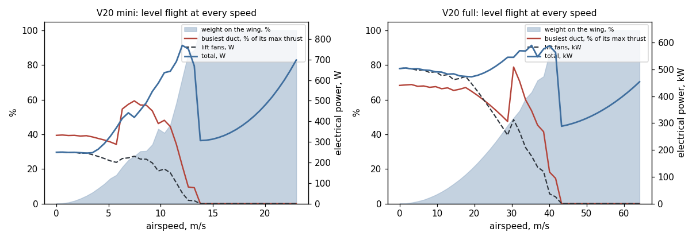

# V20 "Falcon Jet": one shape, two scales

> **Status.** The mini is a buildable, 3D-printable experimental RC model: generated parts, a print set that fits the P1S, a parts list and a bench port map - not yet printed, bench-tested or flown. The full-scale aircraft is an **engineering concept study** of the same shape carrying one person: sizing, packaging and a regulatory path. It is not a build package and nothing here makes it airworthy. A person-carrying aircraft needs licensed aerospace engineering, structural and propulsion testing, a hazard analysis and FAA approval before anyone sits in it.

## The answer

|  | V20 mini (printable RC) | V20 full (single-seat concept) |
|---|---:|---:|
| Scale | 1 : 10 | 1 : 1 |
| Length x span | 995 x 710 mm | 9.95 x 7.10 m |
| Lift ducts | 4 x 156 mm, one 6-inch 3-blade prop each, exit vanes | 4 x 1.56 m, two contra-rotating 5-blade fans each, exit vanes |
| Cruise engine | 64 mm EDF (Freewing E7206) | 0.64 m ducted fan, 588 kW |
| Power source | 4S2P Li-ion, 9 Ah, 90 A | series hybrid: 397 kW turbogenerator + 28 kWh battery |
| Mass | 1,540 g | 1,540 kg (pilot 100 kg, battery 154 kg, fuel 96 kg) |
| CG from the centre of the 4 fans | +0.0 mm | +0 mm |
| Hover power | 250 W | 503 kW |
| Lift thrust / weight | 2.54 | 1.47 rated (one rotor may fail) |
| Static margin: ducts open / 25 % blocked (gate) / closed | 10.3 / **5.5** / -8.9 % | 10.3 / **5.5** / -8.9 % |
| Slowest wing-borne flight (trimmed CL at 14 deg) | 13.6 m/s (CL 0.40) | 42.9 m/s, 83 kt (CL 0.40) |
| Cruise | 17.6 m/s, 373 W | 201 km/h, 361 kW, L/D 4.2 |
| Endurance / mission | 25 min hover or 17 min cruise (model) | 20 km hop + 20 min VFR reserve |
| Hover and forward flight at every speed (quasi-steady model) | yes, 0-23 m/s | yes, 0-64 m/s |

The two are the same outer mould line by construction (`tools/v20/v20params.py`, generated by `tools/v20/geometry.py`); only what sits inside changes. The mini is the flying test article for the shape, the control laws and the transition, at a scale where a mistake costs a print.

## Why it looks like this

**Hover first.** Four lift fans in a square; the CG goes where their diagonals cross, so each fan lifts a quarter of the weight and every fan keeps the same control headroom. The heaviest movable item is the trim weight: on the mini the battery (pack centre x 332 mm, in the nose); on the full-scale aircraft the battery too, in the nose bay ahead of the pilot's feet (centroid x 2.22 m), balancing the turbogenerator behind the seat and the tail.

**Then fly.** For wing-borne flight the neutral point must sit behind that same point. A duct sunk in a wing sits at about half the local chord, but a delta's neutral point sits at about a third of its mean chord, so a 2 x 2 square of ducts spread through a delta puts the CG far behind the neutral point. The first layouts tried here were 15-25 % of the mean chord unstable. The fix is the layout you see:

- the ducts sit in the **forward half** of a large cranked delta (front pair in strakes beside the cockpit, rear pair in the wing roots), as close together as the lips allow;
- the ducts are **big**: 1.56 m at full scale (6-inch props on the mini). The first V20 draft had 1.06 m ducts; at that size the full-scale disk loading was over 350 kg/m2 and the aircraft did not close under honest assumptions. Bigger ducts need wider strakes, which is why the planform reaches further out than a fighter's;
- the wing carries on well behind them, with a forward-swept trailing edge outboard;
- **all-moving stabilators** of 3.2 m semi-span add the rest; the vortex lattice puts the neutral point 10.3 % of the mean chord behind the CG with the ducts open, after the fuselage's destabilising moment (about 3 % of margin, Raymer's method) is taken off.
- The ducts stay **open in cruise** (fans stopped). Open and closed ducts bound the real case: a stopped fan, its hub and stators block part of each duct, which puts lift back over the front pair. Closed, the margin is -8.9 %; the design gate is **5 % or more at 25 % blockage**, and the V20 has 5.5 %. How much a parked fan really blocks is a wind-tunnel number - measure it on the mini (Stage 1) before trusting either end. Louvre doors are not in this layout for the same reason.

**The jet.** One ducted cruise fan in the tail cone, fed by two side intakes under the strakes, exhausts through a round nozzle: in the mini the V18's own 64 mm EDF sits at the intake throat with a film thrust tube to the nozzle (that keeps its 142 g near the CG). Twin canted fins with rudders, elevons on the outer wing, a gold-tinted canopy.

## Hover at any point, fly forward at any point

At every speed from a standstill to top speed the model searches the wing's angle of attack and the pitch surfaces for the cheapest level-flight solution: the wing carries what it can, the four fans carry the rest and trim the pitch with front/rear differential thrust, and the cruise fan beats the drag - including the lift ducts' **momentum drag** (air taken in at flight speed and thrown down costs drag in proportion to speed). That drag is the classic fan-in-wing problem: on the full-scale aircraft it reaches several kilonewtons mid-transition, so its ducts get **exit vanes** (as on the 1960s XV-5 fan-in-wing) that turn the efflux aft by up to 30 deg. The mini has them too (up to 15 deg, one servo per side): without them its 64 mm EDF cannot beat the momentum drag at 12-13 m/s and the corridor has a gap.

Mini (W):

| m/s | On wing % | Alpha deg | Pitch surfaces deg | Front / rear duct thrust, % of rated | Vanes deg | Power | Can stop and hover |
|---|---:|---:|---:|---:|---:|---:|---:|
| 0.0 | 0 | 0.0 | 0.0 | 39 / 39 | 0 | 250 | yes |
| 2.9 | 4 | 13.5 | -5.0 | 39 / 39 | 15 | 246 | yes |
| 5.8 | 16 | 13.0 | -6.0 | 34 / 34 | 15 | 368 | yes |
| 8.6 | 30 | 4.0 | 13.0 | 57 / 0 | 15 | 491 | yes |
| 11.5 | 58 | 13.5 | -11.0 | 0 / 34 | 15 | 690 | yes |
| 14.4 | 100 | 12.5 | -5.5 | 0 / 0 | 0 | 308 | yes |
| 17.2 | 100 | 8.7 | -3.8 | 0 / 0 | 0 | 361 | yes |
| 20.1 | 100 | 6.4 | -2.8 | 0 / 0 | 0 | 485 | yes |
| 23.0 | 100 | 4.9 | -2.2 | 0 / 0 | 0 | 698 | yes |

Full (kW):

| m/s | On wing % | Alpha deg | Pitch surfaces deg | Front / rear duct thrust, % of rated | Vanes deg | Power | Can stop and hover |
|---|---:|---:|---:|---:|---:|---:|---:|
| 0.0 | 0 | 0.0 | 0.0 | 68 / 68 | 0 | 503 | yes |
| 8.0 | 4 | 13.5 | -5.0 | 67 / 66 | 10 | 496 | yes |
| 16.1 | 14 | 13.5 | -5.0 | 66 / 64 | 25 | 476 | yes |
| 24.1 | 31 | 13.5 | -5.0 | 57 / 51 | 30 | 497 | yes |
| 32.1 | 54 | 10.5 | 2.0 | 71 / 2 | 30 | 569 | yes |
| 40.1 | 87 | 13.5 | -5.0 | 18 / 2 | 30 | 588 | yes |
| 48.1 | 100 | 11.1 | -4.9 | 0 / 0 | 0 | 307 | yes |
| 56.2 | 100 | 8.2 | -3.6 | 0 / 0 | 0 | 364 | yes |
| 64.2 | 100 | 6.3 | -2.8 | 0 / 0 | 0 | 454 | yes |

'Can stop and hover' means the four fans alone could take the full weight right now with 20 % of their thrust still in hand for control, and the power source could supply that 20 % extra on all four. Every solution in the table also stays inside the power source's limit (on the mini, the 90 A pack carries the lift fans and the EDF together). It is true at every speed on both scales: the fans are sized for hover, so the aircraft can always fall back to the drone. This is a **quasi-steady** model: each speed is solved on its own, without gusts, acceleration, pitch dynamics or fan-wing interference - it says a path exists, not that a pilot or autopilot can fly it. Flight test on the mini decides that.

## Build the mini

**Print set.** `cad/v20/mini/v20_mini_print_set.3mf` and `cad/v20/mini/stl/`: 33 pieces, every one fits the P1S bed (pieces were cut with flat joints where a part was too big). Print the airframe in LW-PLA (foamed to about 0.6 g/cm3, one 0.45 mm wall, gyroid ribs), ducts and nozzle in PETG, the canopy as a buck for a 0.5 mm vacuum-formed PETG shell. Glue the joints with the carbon spars running through them: a 6 mm main spar behind the rear ducts in two halves that plug into a printed ring around the thrust tube, a 4 mm centre spar through the strip between the front and rear ducts, and a short 6 mm keel tube from behind the battery to the EDF. The exit vanes are printed too (four per duct, hinged spanwise on 1 mm wire).

| Piece | P1S | Footprint mm | Height mm |
|---|---:|---:|---:|
| `canopy` | fits | 200 | 68 |
| `duct_front_L` | fits | 136 | 168 |
| `duct_front_R` | fits | 136 | 168 |
| `duct_rear_L` | fits | 136 | 168 |
| `duct_rear_R` | fits | 136 | 168 |
| `elevon_L` | fits | 60 | 170 |
| `elevon_R` | fits | 60 | 170 |
| `fin_L` | fits | 59 | 196 |
| `fin_R` | fits | 59 | 196 |
| `fuselage_p1` | fits | 83 | 250 |
| `fuselage_p2` | fits | 90 | 249 |
| `fuselage_p3` | fits | 91 | 249 |
| `fuselage_p4` | fits | 84 | 249 |
| `intake_L` | fits | 28 | 90 |
| `intake_R` | fits | 28 | 90 |
| `nozzle` | fits | 66 | 66 |
| `nozzle_cone` | fits | 24 | 48 |
| `rudder_L` | fits | 35 | 130 |
| `rudder_R` | fits | 35 | 130 |
| `stabilator_L` | fits | 223 | 200 |
| `stabilator_R` | fits | 223 | 200 |
| `vanes_front_L` | fits | 74 | 149 |
| `vanes_front_R` | fits | 74 | 149 |
| `vanes_rear_L` | fits | 74 | 149 |
| `vanes_rear_R` | fits | 74 | 149 |
| `wing_L_p1` | fits | 236 | 178 |
| `wing_L_p2` | fits | 234 | 178 |
| `wing_L_p3` | fits | 236 | 162 |
| `wing_L_p4` | fits | 201 | 130 |
| `wing_R_p1` | fits | 234 | 178 |
| `wing_R_p2` | fits | 236 | 178 |
| `wing_R_p3` | fits | 201 | 130 |
| `wing_R_p4` | fits | 236 | 162 |

**Masses** (model, 1,540 g): airframe 392 g, propulsion 374 g, avionics 60 g, controls 51 g, systems 50 g, gear 32 g, battery 580 g.

**Parts to buy** (reference candidates; buy one lift motor and one prop first and measure them on the repo's thrust stand before the rest):

| ID | Item | Reference candidate | Qty | USD |  |
|---|---:|---:|---:|---:|---:|
| M01 | Lift motors (4 + 1 spare) | 2207 class, 2400-2700 KV, 4S (6-inch freestyle class; compare published thrust tables, then measure your own) | 5 | 90-130 | [link](https://www.miniquadtestbench.com/) |
| M02 | Lift props, 6-inch 3-blade (2 sets of CW + CCW) | 6 x 3-4 x 3 tri-blade, 5 mm bore | 8 | 10-18 | [link](https://www.amazon.com/s?k=6+inch+3+blade+fpv+prop) |
| M03 | 4-in-1 lift ESC | V18 row P06: Hobbywing XRotor Micro 60A 4-in-1 | 1 | 65-100 | [link](https://www.hobbywing.com/en/products/xrotor-micro-60a-4in1-blheli-32-dshot1200117) |
| M04 | Cruise EDF, 64 mm | V18 row P07: Freewing E7206 64 mm 4S | 1 | 60-85 | [link](https://www.freewingmodel.com/747.html) |
| M05 | EDF ESC | V18 row P08: Hobbywing Skywalker 60A V2 | 1 | 35-45 | [link](https://www.hobbywingdirect.com/products/skywalker-esc-60a) |
| B01 | Li-ion cells for a 4S2P pack (+ 1 spare) | Molicel P45B 21700, 4.5 Ah, 45 A, about 70 g | 9 | 30-45 | [link](https://www.getfpv.com/batteries/18650-batteries/molicel-p45b-21700-4500mah-45a-3-7v-li-ion-battery-2pcs.html) |
| B02 | Pack build: nickel strip rated for 90 A, balance lead, XT90, fish paper, heat-shrink (or a pre-built 4S2P P45B pack) | spot-welded, never soldered to the cells | 1 | 20-40 | [link](https://www.amazon.com/s?k=4s2p+21700+p45b+pack) |
| B03 | Li-ion-capable 4S balance charger | V18 row X07 (set to Li-ion, 4.2 V/cell, 4.5 A) | 0 | - | [link](https://www.amazon.com/s?k=lipo+balance+charger+4s) |
| A01 | Flight controller | V18 row A01: SpeedyBee F405 WING | 1 | 50-80 | [link](https://ardupilot.org/plane/docs/common-speedybeef405wing.html) |
| A02 | ELRS receiver | V18 row A03: RadioMaster RP1 V2 | 1 | 19-25 | [link](https://radiomasterrc.com/products/rp1-expresslrs-2-4ghz-nano-receiver) |
| A03 | GNSS + compass | V18 row A04: M10 GNSS with I2C compass | 1 | 25-50 | [link](https://ardupilot.org/plane/docs/common-positioning-landing-page.html) |
| A04 | Airspeed sensor + pitot | V18 row A05: Matek ASPD-4525 | 1 | 35-65 | [link](https://www.mateksys.com/?portfolio=aspd-4525) |
| A05 | Servos (2 elevons, 2 stabilators, 1 rudders, 2 exit vanes + 1 spare) | 5 g digital micro servo, metal gear | 8 | 48-80 | [link](https://www.amazon.com/s?k=5g+digital+metal+gear+micro+servo) |
| A06 | Lost-model alarm | V18 row A06: VIFLY Finder 2 | 1 | 10-14 | [link](https://www.getfpv.com/vifly-finder-2-drone-buzzer.html) |
| V01 | FPV camera, 19 mm (pilot's eye) | V18 row V01: RunCam Phoenix 2 | 1 | 30-40 | [link](https://shop.runcam.com/runcam-phoenix-2/) |
| V02 | VTX + antenna | V18 row V02 | 1 | 25-45 | [link](https://www.runcam.com/download/RunCam-TX200U-US-manual.pdf) |
| S01 | Carbon tubes: 6 x 4 mm (main spar + keel), 4 x 2 mm (centre spar), 1 m each | pultruded carbon | 3 | 15-30 | [link](https://www.amazon.com/s?k=carbon+fiber+tube+6mm+4mm+1000mm) |
| S02 | Clear PETG sheet 0.5 mm (vacuum-formed canopy; spares) | A4 sheets | 3 | 8-15 | [link](https://www.amazon.com/s?k=petg+sheet+0.5mm+clear) |
| S03 | PET film 0.2 mm (EDF thrust tube) | A4 sheets | 2 | 6-10 | [link](https://www.amazon.com/s?k=0.2mm+pet+film+sheet) |
| S04 | Landing gear: 1.5 mm music wire, 30 mm foam wheels x3, wheel collars |  | 1 | 10-18 | [link](https://www.amazon.com/s?k=30mm+foam+wheels+rc) |
| S05 | Pushrods, clevises, horns, pull-pull cable for the rudders | 1.2 mm wire set | 1 | 8-12 | [link](https://www.amazon.com/s?k=rc+pushrod+clevis+control+horn+set) |
| C01 | Filament: LW-PLA (airframe), PETG (ducts, nozzle, mounts) | V18 row C05 | 1 | 35-55 | [link](https://www.amazon.com/s?k=lw-pla+filament) |

**Battery.** A 4S2P Li-ion pack of eight 21700 cells (Molicel P45B class: 4.5 Ah, 45 A continuous, about 70 g each) as two 2 x 2 bundles end to end in the nose: 9 Ah and 90 A, 580 g. Hover needs about 19 A; the model keeps lift fans + EDF under 1,010 W (85 % of 90 A at 13.2 V under load) everywhere in the corridor, so the EDF runs to full throttle and `Q_M_BAT_CURR_MAX` is 76 A. Li-ion gives about 40 % more energy per kilogram than LiPo, which long hovers want; the price is current, which is why the pack is 2P. Lift thrust is limited by the battery power (lift thrust/weight 2.54).

**Wiring.** SpeedyBee F405 WING, ArduPilot QuadPlane (quad X), bench-only port map in `config/ardupilot/skyforge_v20_mini_BENCH_ONLY.param`:

| Output | ArduPilot function | Goes to | Note |
|---|---:|---:|---:|
| S1 | 33 Motor1 | 4-in-1 M1: front-right duct (CCW) | DShot group 1-2 |
| S2 | 34 Motor2 | 4-in-1 M2: rear-left duct (CCW) | DShot group 1-2 |
| S3 | 35 Motor3 | 4-in-1 M3: front-left duct (CW) | DShot group 3-4 |
| S4 | 36 Motor4 | 4-in-1 M4: rear-right duct (CW) | DShot group 3-4 |
| S5 | 77 Elevon left | left elevon servo | PWM 50 Hz, group 5-7 |
| S6 | 78 Elevon right | right elevon servo | PWM 50 Hz, group 5-7 |
| S7 | 77 Elevon left | left stabilator servo | stabilators mix like elevons (pitch + roll); reverse if needed |
| S8 | 78 Elevon right | right stabilator servo | group 8-10 |
| S9 | 21 Rudder | rudder servo (pull-pull to both rudders) | group 8-10 |
| S10 | 94 Script1 | right exit-vane servo (front + rear right ducts) | group 8-10; needs a vane-mixing Lua script (open item) |
| S11 | 70 Throttle | EDF ESC signal | group 11-12; full throttle allowed (the 90 A pack covers EDF + lift fans) |
| S12 | 95 Script2 | left exit-vane servo (front + rear left ducts) | group 11-12; same script |
| UART1 | SERIAL1_PROTOCOL 23 | ELRS receiver (CRSF) | Rx TX -> R1, Rx RX -> T1 |
| UART3 | SERIAL3_PROTOCOL 5 | M10 GNSS | compass on I2C |
| I2C | ARSPD_TYPE 1 | ASPD-4525 airspeed | pitot through the nose, 30 mm ahead of the skin |

**Gates before the first hover** (on top of the repo's Stage 0-10):

- Thrust stand: one ducted 6-inch prop on its motor gives at least 0.98 kg at full throttle on 4S (the model's limit, set by a quarter of the pack's power); below that, change motor or prop before printing the strakes.
- Weigh and balance: the CG within 3 mm of x 456 mm (centre of the four ducts); move the pack, not ballast.
- Duct tip gap: 1.7 mm in the model (measured from the meshes) - check it all round with a feeler, no rub when you flex the strake by hand.
- Props off: motor order and direction per the port map, every surface moves the right way in every mode.
- Tethered hover: hover throttle 40-50 %, no oscillation; then free hover; then transitions in steps of 2 m/s.
- Battery current: logged peak under 76 A in hover and transition.
- Airspeeds: AIRSPEED_MIN 19 m/s and Q_ASSIST_SPEED 17 m/s come from the model's 13.6 m/s slowest wing-borne speed; confirm the real stall in a climb before lowering them.

## The full-scale aircraft (concept study)

**Why it is a hybrid.** With honest efficiencies (fan figure of merit 0.70, cruise-fan system 0.55, the delta's drag due to lift, a usable CL from the trimmed lattice) and the legal VFR reserve, an all-electric version of this shape does not close at any size or distance in the trade study below - not at 220 Wh/kg and not at 300. Two things do it: even with four 1.56 m ducts the disk loading is 201 kg/m2 (an open-rotor eVTOL runs 50-100), so hover takes 503 kW; and the low-aspect-ratio delta cruises at L/D 4.2, so the 20-minute reserve alone is 129 kWh. Jet fuel carries that reserve for a fraction of a battery's mass. The V20 full scale is therefore a **series hybrid**: a turboshaft-driven generator right behind the seat (a flush inlet on the spine, two insulated exhaust pipes either side of the cruise fan into its thrust tube, so the exhaust leaves through the jet nozzle) carries cruise and the reserve; fuel sits in wing tanks outboard of the ducts; a high-power battery in the nose carries hover and transition and balances the tail. That is the conclusion the 1960s fan-in-wing XV-5 reached with turbojets: this shape is a jet-fuel aircraft.

Closed sizing loop (`tools/v20/sizing.py`): pilot 100 kg; generator 397 kW (cruise and reserve power + 10 %) at 1.5 kW/kg and 0.5 kg of fuel per kWh; battery 180 Wh/kg at pack level, sized by power (hover minus generator) at 10C; lift motors and inverters rated so that **any one of the eight rotors can fail** - re-splitting thrust onto the diagonal keeps pitch and roll trimmed, and the busiest healthy rotor then carries 1/6 of the weight (+10 % for control), for the 60 s it takes to land; cruise fan sized to beat the drag from 1.1 x stall to 1.15 x cruise speed; structure from the generated wetted areas at composite areal densities; systems including a triplex flight-control system and a ballistic parachute.

| Group | Mass |
|---|---:|
| structure | 434 kg |
| payload | 100 kg |
| systems | 106 kg |
| propulsion | 650 kg |
| fuel | 96 kg |
| battery | 154 kg |
| **MTOW** | **1,540 kg** |

Mission (60 s hover + 30 s transition, 20 km at 201 km/h, transition and 60 s hover, then a 20 min reserve + 60 s hover): hover 17, transition 6, cruise 36, reserve 129 kWh at the bus; the generator supplies 183 kWh (96 kg, 120 L of Jet A in the wing tanks, whose centroid is close to the fan centre: burning it all moves the CG 6 mm forward) and the battery 5 kWh of its 28 kWh. Battery power is sized for the larger of hover with 20 % thrust in hand and the transition's peak (from the corridor), less the generator; the cruise fan's thrust for the transition's momentum drag as well as cruise.

**The open safety item: turbine out in a low hover.** The battery is sized for hover power minus the generator, so with the turbine stopped it supplies 55 % of hover power - about 67 % of the thrust needed. Above parachute height that is a parachute or a powered descent; in a low hover it is a hard landing. Single-engine helicopters live with the same kind of height-velocity avoid region. The safe rule - the battery alone holds a 60 s hover - is in the trade study and does **not** close at this size; twin turbogenerators, larger ducts or a lower disk loading are the ways out, and a real program would have to pick one.

Trade study (same shape scaled by k; cruise distance; powertrain; every row carries the 20 min reserve):

| Scale k | Cruise km | Powertrain | MTOW kg | Battery kg | Fuel kg | Hover kW |
|---|---:|---:|---:|---:|---:|---:|
| 1.0 (9.9 m, 1.56 m ducts) | 10 | hybrid | 1,489 | 146 | 83 | 478 |
| 1.0 (9.9 m, 1.56 m ducts) | 10 | hybrid, turbine-out hover on battery | does not close | - | - | - |
| 1.0 (9.9 m, 1.56 m ducts) | 10 | battery 220 Wh/kg | does not close | - | - | - |
| 1.0 (9.9 m, 1.56 m ducts) | 10 | battery 300 Wh/kg | does not close | - | - | - |
| 1.0 (9.9 m, 1.56 m ducts) | 20 | hybrid | 1,540 | 154 | 96 | 503 |
| 1.0 (9.9 m, 1.56 m ducts) | 20 | hybrid, turbine-out hover on battery | does not close | - | - | - |
| 1.0 (9.9 m, 1.56 m ducts) | 20 | battery 220 Wh/kg | does not close | - | - | - |
| 1.0 (9.9 m, 1.56 m ducts) | 20 | battery 300 Wh/kg | does not close | - | - | - |
| 1.0 (9.9 m, 1.56 m ducts) | 50 | hybrid | 1,890 | 228 | 162 | 684 |
| 1.0 (9.9 m, 1.56 m ducts) | 50 | hybrid, turbine-out hover on battery | does not close | - | - | - |
| 1.0 (9.9 m, 1.56 m ducts) | 50 | battery 220 Wh/kg | does not close | - | - | - |
| 1.0 (9.9 m, 1.56 m ducts) | 50 | battery 300 Wh/kg | does not close | - | - | - |
| 1.2 (11.9 m, 1.87 m ducts) | 10 | hybrid | 1,807 | 193 | 93 | 533 |
| 1.2 (11.9 m, 1.87 m ducts) | 10 | hybrid, turbine-out hover on battery | does not close | - | - | - |
| 1.2 (11.9 m, 1.87 m ducts) | 10 | battery 220 Wh/kg | does not close | - | - | - |
| 1.2 (11.9 m, 1.87 m ducts) | 10 | battery 300 Wh/kg | does not close | - | - | - |
| 1.2 (11.9 m, 1.87 m ducts) | 20 | hybrid | 1,841 | 194 | 106 | 548 |
| 1.2 (11.9 m, 1.87 m ducts) | 20 | hybrid, turbine-out hover on battery | does not close | - | - | - |
| 1.2 (11.9 m, 1.87 m ducts) | 20 | battery 220 Wh/kg | does not close | - | - | - |
| 1.2 (11.9 m, 1.87 m ducts) | 20 | battery 300 Wh/kg | does not close | - | - | - |
| 1.2 (11.9 m, 1.87 m ducts) | 50 | hybrid | 1,951 | 196 | 151 | 598 |
| 1.2 (11.9 m, 1.87 m ducts) | 50 | hybrid, turbine-out hover on battery | does not close | - | - | - |
| 1.2 (11.9 m, 1.87 m ducts) | 50 | battery 220 Wh/kg | does not close | - | - | - |
| 1.2 (11.9 m, 1.87 m ducts) | 50 | battery 300 Wh/kg | does not close | - | - | - |

Only the hybrid closes, up to 50 km in this table. Scaling the whole aircraft up does not rescue the all-electric version: structure and drag grow as fast as fan area. Mass grows steeply with distance because every kilogram of fuel and generator raises the hover power, and hover power sizes the battery and the motors.

**Safety architecture (what a real program would have to carry):**

- Eight motors in four coaxial ducts. Any one motor, inverter or blade-out leaves enough thrust (sized above); the lost rotor's torque is no longer cancelled, so yaw must be held by the other pairs' differential speed, the exit vanes and the rudders - not yet checked by this model. A motor failure in mid-transition is also an open item. Ducts contain blade fragments only if the shroud is designed and tested for it.
- Triplex fly-by-wire with independent air-data and attitude sources; the aircraft is a hover machine first and has no unpowered hover.
- Turbine out: see above - the avoid region has to be closed or flown around.
- Battery split into isolated strings with contactors, thermal-runaway barriers and venting overboard; the nose bay is forward of the pilot's feet, so the crash case and the fire case both need a firewall. Fuel tank crash-resistant and separated from the battery bays.
- Ballistic recovery parachute behind the canopy for loss of control or power in cruise and climb. It needs height and some speed to open, so it does **not** protect a low hover or the start of a transition.
- Duct exit vanes for transition thrust and yaw; elevons and stabilators for wing-borne control; the cruise fan is not needed to land.
- Fuel and energy state and power margin shown to the pilot at all times.

**Regulatory path, full scale (United States).** This aircraft is far outside Part 103 ultralight limits (single occupant, under 254 lb empty, 55 kt maximum, 24 kt stall: see [EAA's summary of 14 CFR 103](https://www.eaa.org/eaa/aviation-interests/ultralights/getting-started-in-ultralight-flying/about-faa-part-103-for-ultralights)), so it would need an FAA airworthiness certificate - for a privately built one-off, a special airworthiness certificate in the experimental category - and a pilot qualified for powered-lift under the FAA's 2024 powered-lift rule, SFAR 120 ([FAA](https://www.faa.gov/newsroom/integration-powered-lift-pilot-certification-and-operations-miscellaneous-amendments)). **Reserve:** under 14 CFR 194.302 (SFAR 120, Table 1, row l) a powered-lift that can land in the vertical-lift mode along the whole route may use the rotorcraft VFR rule, 14 CFR 91.151(b): fuel to the first intended landing plus 20 minutes at normal cruise ([final rule](https://public-inspection.federalregister.gov/2024-30331.pdf), [91.151](https://www.law.cornell.edu/cfr/text/14/91.151)); otherwise the airplane rule applies, 30 minutes by day and 45 at night. The sizing uses 20 minutes plus a 60 s hover for that vertical landing. Which experimental purpose applies to a powered-lift one-off, and what testing the FAA would want, is a question for the local FAA office (FSDO/MIDO) and a Designated Airworthiness Representative before any metal is cut. This is a summary, not legal advice.

**The mini's rules (United States).** At about 1.5 kg it is a small unmanned aircraft: register it with the FAA (over 250 g), fly it with a standard Remote ID module or broadcast, or at an FAA-recognized identification area; as a recreational flyer pass TRUST and fly under 400 ft in uncontrolled airspace (or get a LAANC authorization in controlled airspace) and keep it in sight - FPV needs a visual observer beside you; flying it for work needs a Part 107 certificate ([FAA recreational flyers](https://www.faa.gov/uas/recreational_flyers), [Remote ID](https://www.faa.gov/uas/getting_started/remote_id)).

**Before anyone flies in one:** detailed structural design and analysis with test articles; duct and rotor burst containment testing; battery abuse testing; turbine and fuel-system qualification; a functional hazard assessment and failure-modes analysis of the flight control system; a scale-model and then unmanned full-scale flight-test program (the mini is step one); and a team with aerospace engineers who sign for the work.

## How the numbers were made

- `tools/v20/v20params.py`: the master shape (full-scale metres). `tools/v20/geometry.py`: meshes for both scales, the mini print set and the checks (insides within the fuselage, prop tip gap, P1S fit). `tools/v20/aero.py`: vortex lattice of the planform with the duct holes and the stabilators (same solver as `tools/aero_vlm.py`, within 0.3 % of AeroSandbox) plus Raymer's fuselage correction. `tools/v20/sizing.py`: masses and CG, momentum-theory hover power with figures of merit, Raymer flat-plate drag build-up, the corridor search, the full-scale sizing loop and the trade study.
- Assumptions to replace with measurements first: LW-PLA areal density (Stage 1 coupons), ducted 6-inch thrust and current (thrust stand), the EDF's thrust and power at speed, the fan figures of merit (mini 0.48, full 0.70), the duct-hole drag and blockage, the leading-edge suction (mini 0.2, full 0.5), the turbogenerator's mass and fuel burn. Every number in this document moves when those do; rerun `make v20`.
- Not modelled: duct lip suction and fan-wing interference in transition (they help lift and hurt pitch), ground effect, gusts, the dynamics of the transition (this is a quasi-steady corridor), structural loads and flutter.

