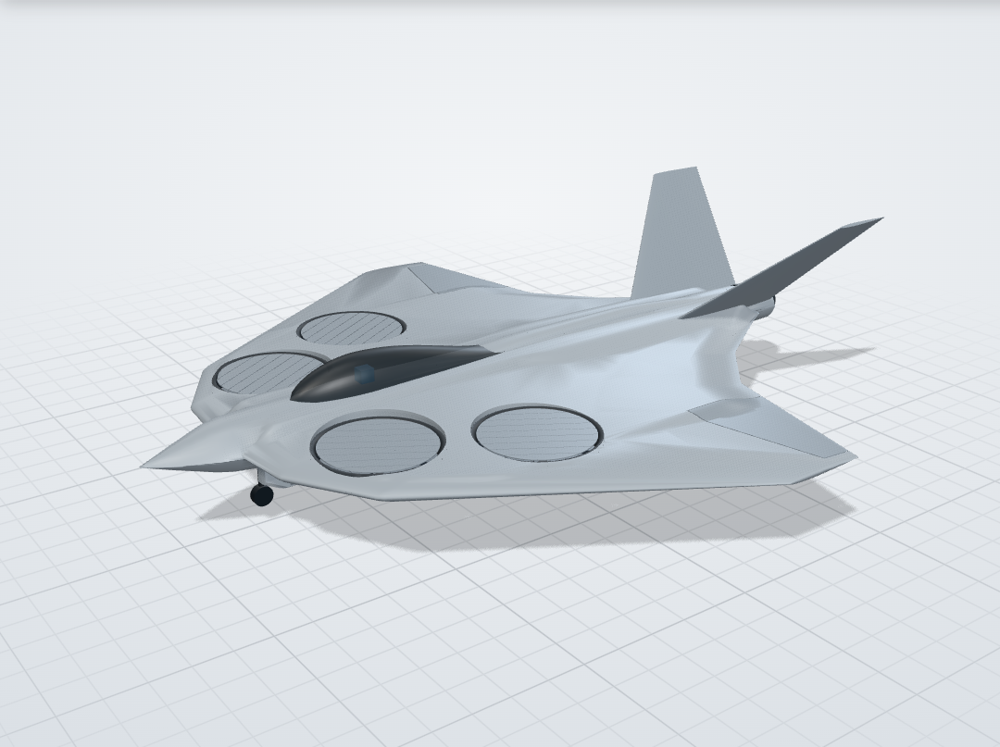
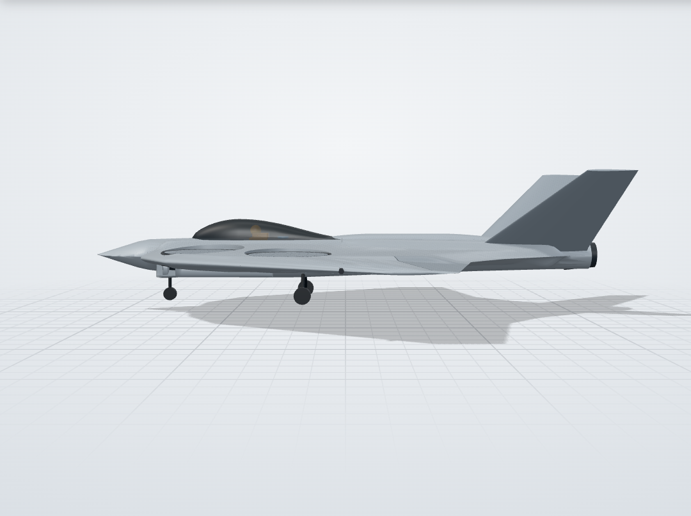

# V20 "Falcon Jet" (rev C.2): one blended body, staggered hidden fans, a V-tail and a payload bay

> **Status.** The mini is a buildable, 3D-printable experimental RC model: generated parts, a print set that fits the P1S (with a balance stand), a foam template, a parts list and a bench port map - not yet printed, bench-tested or flown. The full-scale aircraft is an **engineering concept study** of the same shape carrying one person: sizing, packaging and a regulatory path. It is not a build package and nothing here makes it airworthy. A person-carrying aircraft needs licensed aerospace engineering, structural and propulsion testing, a hazard analysis and FAA approval before anyone sits in it.

## The answer

|  | V20 mini (printable RC) | V20 full (single-seat concept) |
|---|---:|---:|
| Scale | 1 : 10 of the full-scale shape (exactly) | 1 : 1 |
| Length x span | 1,080 x 1,000 mm | 10.8 x 10.0 m |
| Lift fans (hidden under louvres, staggered chevron) | 4 x 157 mm ducts, one 6-inch 3-blade prop each | 4 x 1.57 m ducts, two contra-rotating 5-blade fans each |
| Tail | V-tail: two all-moving ruddervators (3 mm Depron) | V-tail: two all-moving ruddervators |
| Jet | 64 mm EDF (Freewing E7206), fed by both side intakes | 0.64 m electric ducted fan, 526 kW |
| Power source | 4S3P Li-ion, 13.5 Ah, 135 A | series hybrid: 420 kW turbogenerator + 92 kWh battery |
| Mass | 1,995 g | 2,235 kg (pilot 100 kg, battery 509 kg, fuel 92 kg) |
| Payload | up to 265 g in a 90 x 54 x 18 mm bay at the CG | 55 L belly bay; uncrewed cargo version 122 kg |
| CG from the centre of the 4 fans | +0.0 mm | +0 mm |
| Hover power | 351 W | 874 kW (289 kg/m2 of fan) |
| Lift thrust / weight | 1.90 | 1.47 rated (one rotor may fail) |
| Static margin, louvres shut (gate) / open | **5.9** / 16.1 % (gate 5 %) | **5.9** / 16.1 % (gate 5 %) |
| Weathercock stability (Cn_beta, per rad) | +0.068 | +0.068 |
| Slowest wing-borne flight (trimmed CL at 14 deg) | 10.6 m/s (CL 0.50) | 35.4 m/s, 69 kt (CL 0.50) |
| Cruise (louvres shut) | 17.6 m/s, 261 W, L/D 5.2 | 236 km/h, 381 kW, L/D 7.9 |
| Endurance / mission | 27 min hover or 36 min cruise (38 km) | 20 km hop + 20 min VFR reserve |
| Hover and forward flight at every speed (quasi-steady model) | yes, 0-23 m/s | yes, 0-76 m/s |

**Rev B to rev C.2, the mini** (rev B is v0.8.0):

|  | Rev B | Rev C.2 |
|---|---:|---:|
| Span | 760 mm | 1,000 mm |
| Aspect ratio | 1.65 | 1.76 |
| Mass | 1,548 g | 1,995 g |
| Hover endurance | 16.8 min | 26.6 min |
| Cruise endurance / range | 25.7 min / 28.4 km | 35.7 min / 37.6 km |
| Cruise L/D | 4.5 | 5.2 |
| Payload | none | up to 265 g |
| Lift thrust / weight | 1.86 | 1.90 |
| Static margin (louvres shut) | 6.7 % | 5.9 % |
| Fan layout | 2 x 2 square | staggered chevron (rear pair 0.9 m further out at full scale) |
| Tail surfaces / servos | 4 surfaces, 3 servos | 2 surfaces, 2 servos |

Bigger 6-inch fans (they hover on less power per kilogram) and a 50 % bigger pack, which the chined nose now holds and which is also the nose weight that puts the CG on the fan centre. Cruise gains are modest: the 64 mm EDF's efficiency, not the airframe, is what limits the mini's range. Lift thrust/weight stays below the 2.0 the repo wants - the thrust stand decides; a stronger 2207 or a 6x4 prop is the fix if it comes in short.

## Why it looks like this

**One body.** A chined forebody - the nose's widest line is a sharp edge - runs straight into the wing leading edge, and the wing root thickens into the body ahead of and behind the fans, so nose, body, wing and aft body read as one lifting shape, the way the Anduril Fury and the other collaborative combat aircraft (CCA) designs do. A low frameless canopy fairs into a dorsal spine that runs back to the tail.

**Hover first.** Four equal lift fans; the CG goes on their centroid, so each fan lifts a quarter of the weight and every fan keeps the same control headroom. The fans live in the shoulders of the body beside the cockpit, under louvres that shut in cruise: on top they open by the fan's own suction and close with a light elastic; underneath they are servo-driven and double as **exit vanes**, turning the efflux aft in transition (as on the 1960s XV-5 fan-in-wing). The battery is the trim weight: the mini's pack sits in the nose (centre x 198 mm), the full-scale pack in the nose bay (centroid x 1.95 m).

**Where the fans go (rev C.2).** The four fans form a staggered chevron that follows the wing's sweep: the front pair tucked against the body beside the cockpit (y = +/-1.43 m full scale), the rear pair 0.9 m further out (y = +/-2.33 m). Rev C had them in a square. The stagger is there for physical reasons, not just the look:

- **Wake.** In transition a fan in line behind another ingests its disturbed inflow and the open louvres' wake. Staggered, the rear fan's disk overlaps the front fan's track by 43 % of its width instead of 100 %.
- **Control arms.** Roll from differential fan thrust and yaw from differential exit vanes both scale with lateral distance: the rear pair's arm grows from 1.43 to 2.33 m (x1.6). The fore-aft spacing - the pitch arm - stays 1.80 m, and the fan centroid, which is the hover balance point, does not move.
- **Room underneath.** The bay between the rear fans and the fuselage is free, so the main landing gear moves forward to 1.1 m behind the CG (rev C: 1.85 m, behind the whole fan band), the rear fans' efflux no longer blasts the wheels and belly, and the mini's louvre servos sit there on a short linkage.
- **Clean leading edge.** The leading-edge extension now reaches further forward, so even the front fans have skin ahead of their lips: a better inflow at the front lip in transition (where fan-in-wing designs first separate) and no duct showing at the edge. That area is ahead of the CG, so the outer wing moved aft to keep the stability margin.
- **Grilles that follow the planform.** The top louvres run parallel to the outer leading edge (they open by the fan's suction, so their direction is free); the bottom louvres stay spanwise, because they turn the efflux aft in transition.

**A V-tail.** Two all-moving ruddervators replace rev B's two stabilators and two fins: they pitch together and yaw apart. The vortex lattice is now non-planar - each panel has its own normal - so the tail's pitch authority (cos^2 of the dihedral) and yaw authority (sin^2) come out of the solver, not a rule of thumb. At 45 deg dihedral it gives a static margin of **5.9 %** with the louvres shut (the forward-most neutral point; the gate) and a weathercock stability Cn_beta of +0.068 per radian after the fuselage's destabilising part (Raymer eq. 16.47). Half the tail area of rev B, two servos instead of three.

**A payload bay at the CG.** The belly between the four fans holds a 90 x 54 x 18 mm bay (mini) behind two conformal doors. Anything carried there - a camera, a sensor, a package to drop - sits on the hover balance point, so swapping or dropping it does not re-trim the aircraft. Bombers and the F-35 keep their weapons bays at the CG for the same reason.

**The jet.** Side intakes under the chines feed one cruise fan near the CG through internal ducts; a thrust tube carries the jet to the nozzle between the ruddervator roots. The intakes give 80 % of the EDF's swept area (EDF practice is 80-100 %); the cruise-power model includes the penalty, and the Stage 2 thrust test runs through the printed intakes.

**One shape at both scales.** Rev B needed a wider-shouldered shape for the full scale (disk loading grows with size). Rev C starts from the full-scale shape, so the mini is an exact 1:10 model with 6-inch props - and the same 5 % stability gate now holds at both scales, so the full scale no longer leans on its fly-by-wire for static stability.

## What it is for

**The mini** carries one payload module at a time in the bay, all plugged into one payload port (output S9):

| Module | What | Reference parts | g | Use |
|---|---:|---:|---:|---:|
| Camera (default) | 4K action camera on a tilt cradle behind a window door; S9 = 7 Mount tilt | RunCam Thumb 2 class (about 10 g) + 5 g servo | 25 | filming, inspection of roofs, masts and solar panels |
| Mapping | the same camera fixed looking straight down, triggered by distance (CAM_TRIGG_DIST) | RunCam Thumb 2 class + printed nadir mount | 20 | photogrammetry maps and 3D models of a site |
| Drop / release | the bay doors open on S9 (28 Gripper) and let a small package fall | printed hook + 5 g servo | 15 | drop a line, a sample bag, a tracker or a marker; carry up to the payload limit |
| Sensor | downward rangefinder + air-quality / weather sensor on I2C | Benewake TF-Luna (5 g) + Bosch BME688 breakout (2 g) | 15 | precision landing, terrain following, air sampling; a weather station while perched |

Payload limit **265 g**: the heaviest module that keeps lift thrust/weight at 1.7 or more (thrust/weight 1.7); the corridor was re-run at that mass and still passes. Full, it hovers 22 min or cruises 32 min.

**On the ground** it keeps working:

- **Perch and watch.** Land on a roof, a ridge or a pole top and stop the motors: the camera, flight controller and a 25 mW video link draw about 5 W, so half the pack runs them for about 16 h and the other half flies it home - wildlife, a building site, a weather station with the sensor module.
- **Field power bank.** The 156 Wh pack charges a phone or a laptop through an XT90 to USB-C PD adapter.
- **Balance and charging stand.** A printed stand (in the print set) holds the aircraft on the fan-centre line by its body shoulders: if it sits level, the CG is right. A slot passes the charging lead to the pack under the canopy hatch, so it charges on display.

**The full-scale aircraft** is a one-seat personal VTOL for 20 km hops with the VFR reserve; its 55 L belly bay at the CG takes a medical kit, survival gear or baggage (about 40 kg); an uncrewed version swaps the cockpit for 122 kg of cargo on the same flight-control computers (same mass and CG, so the sizing holds). On the ground its turbogenerator is a mobile generator: through a ground inverter (an added part) it could export about 100 kW for about 1.4 h on one mission's fuel (65 kg/h at part load) - a field hospital, a disaster site.

## Hover at any point, fly forward at any point

At every speed from a standstill to top speed the model searches the wing's angle of attack and the pitch surfaces for the cheapest level-flight solution: the wing carries what it can, the four fans carry the rest and trim the pitch with front/rear differential thrust, and the cruise fan beats the drag - including the lift ducts' **momentum drag** (air taken in at flight speed and thrown down costs drag in proportion to speed). The bottom louvres double as exit vanes that turn the efflux aft (up to 30 deg full scale, 15 deg on the mini). The louvres are open whenever the fans run (the model then uses the open-duct lattice and the holes' drag) and shut once the wing carries it all.

Mini (W):

| m/s | On wing % | Alpha deg | Pitch surfaces deg | Front / rear duct thrust, % of rated | Vanes deg | Power | Can stop and hover |
|---|---:|---:|---:|---:|---:|---:|---:|
| 0.0 | 0 | 0.0 | 0.0 | 52 / 52 | 0 | 351 | yes |
| 2.9 | 7 | 14.0 | -4.0 | 54 / 46 | 15 | 331 | yes |
| 5.8 | 30 | 8.0 | 20.0 | 75 / 2 | 15 | 457 | yes |
| 8.6 | 58 | 13.5 | -8.0 | 45 / 0 | 15 | 583 | yes |
| 11.5 | 100 | 11.8 | -5.8 | 0 / 0 | 0 | 266 | yes |
| 14.4 | 100 | 7.6 | -3.7 | 0 / 0 | 0 | 236 | yes |
| 17.2 | 100 | 5.2 | -2.6 | 0 / 0 | 0 | 257 | yes |
| 20.1 | 100 | 3.9 | -1.9 | 0 / 0 | 0 | 322 | yes |
| 23.0 | 100 | 3.0 | -1.4 | 0 / 0 | 0 | 450 | yes |

Full (kW):

| m/s | On wing % | Alpha deg | Pitch surfaces deg | Front / rear duct thrust, % of rated | Vanes deg | Power | Can stop and hover |
|---|---:|---:|---:|---:|---:|---:|---:|
| 0.0 | 0 | 0.0 | 0.0 | 68 / 68 | 0 | 874 | yes |
| 9.4 | 7 | 14.0 | -4.0 | 70 / 61 | 15 | 827 | yes |
| 18.9 | 28 | 14.0 | -4.0 | 78 / 35 | 30 | 698 | yes |
| 28.3 | 50 | 11.0 | -3.0 | 79 / 0 | 30 | 849 | yes |
| 37.8 | 100 | 12.3 | -6.0 | 0 / 0 | 0 | 455 | yes |
| 47.2 | 100 | 7.9 | -3.8 | 0 / 0 | 0 | 357 | yes |
| 56.6 | 100 | 5.5 | -2.7 | 0 / 0 | 0 | 347 | yes |
| 66.1 | 100 | 4.0 | -2.0 | 0 / 0 | 0 | 384 | yes |
| 75.5 | 100 | 3.1 | -1.5 | 0 / 0 | 0 | 458 | yes |

'Can stop and hover' means the four fans alone could take the full weight right now with 20 % of their thrust still in hand for control, and the power source could supply that 20 % extra on all four. This is a **quasi-steady** model: each speed is solved on its own, without gusts, acceleration, pitch dynamics or fan-wing interference - it says a path exists, not that a pilot or autopilot can fly it. Flight test on the mini decides that.

## Build the mini

**Print set.** `cad/v20/mini/v20_mini_print_set.3mf` and `cad/v20/mini/stl/`: 45 pieces including the stand, every one a closed solid that fits the P1S bed (larger parts were cut with flat joints). Print the airframe, louvres and bay doors in LW-PLA (foamed to about 0.6 g/cm3, one 0.45 mm wall, gyroid ribs), ducts, nozzle and stand in PETG, the canopy as a buck for a 0.5 mm vacuum-formed PETG shell - the canopy is also the battery hatch (magnets). Cut the two ruddervators from 3 mm Depron with the 1:1 template in `cad/v20/mini/foam/`; each pivots on a 2 mm carbon rod into the spine, where its servo sits. Glue the joints with the carbon spars running through them: a 6 mm main spar behind the rear fans in two halves, and a 4 mm centre spar through the strip between the front and rear fans. Louvres hinge on 0.8 mm music wire.

| Piece | P1S | Footprint mm | Height mm |
|---|---:|---:|---:|
| `bay_door_L` | fits | 22 | 90 |
| `bay_door_R` | fits | 22 | 90 |
| `canopy` | fits | 242 | 66 |
| `duct_front_L` | fits | 140 | 169 |
| `duct_front_R` | fits | 140 | 169 |
| `duct_rear_L` | fits | 140 | 169 |
| `duct_rear_R` | fits | 140 | 169 |
| `elevon_L` | fits | 110 | 185 |
| `elevon_R` | fits | 110 | 185 |
| `fuselage_p1` | fits | 238 | 101 |
| `fuselage_p2` | fits | 254 | 95 |
| `fuselage_p3` | fits | 95 | 136 |
| `fuselage_p4` | fits | 94 | 136 |
| `fuselage_p5` | fits | 224 | 92 |
| `intake_L` | fits | 51 | 250 |
| `intake_R` | fits | 51 | 250 |
| `louvres_front_L` | fits | 110 | 155 |
| `louvres_front_R` | fits | 110 | 155 |
| `louvres_rear_L` | fits | 110 | 155 |
| `louvres_rear_R` | fits | 110 | 155 |
| `nozzle` | fits | 66 | 66 |
| `nozzle_cone` | fits | 24 | 48 |
| `spine_p1` | fits | 32 | 230 |
| `spine_p2` | fits | 37 | 230 |
| `stand_base` | fits | 139 | 230 |
| `stand_post_L` | fits | 44 | 98 |
| `stand_post_R` | fits | 44 | 98 |
| `vanes_front_L` | fits | 110 | 155 |
| `vanes_front_R` | fits | 110 | 155 |
| `vanes_rear_L` | fits | 110 | 155 |
| `vanes_rear_R` | fits | 110 | 155 |
| `wing_L_p1` | fits | 184 | 232 |
| `wing_L_p2` | fits | 208 | 250 |
| `wing_L_p3` | fits | 164 | 250 |
| `wing_L_p4` | fits | 206 | 229 |
| `wing_L_p5` | fits | 186 | 238 |
| `wing_L_p6` | fits | 156 | 238 |
| `wing_L_p7` | fits | 77 | 226 |
| `wing_R_p1` | fits | 164 | 250 |
| `wing_R_p2` | fits | 184 | 232 |
| `wing_R_p3` | fits | 208 | 250 |
| `wing_R_p4` | fits | 156 | 238 |
| `wing_R_p5` | fits | 77 | 226 |
| `wing_R_p6` | fits | 206 | 229 |
| `wing_R_p7` | fits | 186 | 238 |

**Masses** (model, 1,995 g): airframe 529 g, propulsion 370 g, avionics 60 g, controls 56 g, systems 50 g, gear 34 g, payload 25 g, battery 870 g.

**Parts to buy** (reference candidates; buy one lift motor and one prop first and measure them in a printed duct on the repo's thrust stand before the rest):

| ID | Item | Reference candidate | Qty | USD |  |
|---|---:|---:|---:|---:|---:|
| M01 | Lift motors (4 + 1 spare) | 2207 class, 1900-2100 KV, 4S (6-inch long-range quad motors); measure one with its prop in a printed duct on the thrust stand first: the sizing assumes 0.95 kg | 5 | 90-130 | [link](https://www.miniquadtestbench.com/low-kv/) |
| M02 | Lift props, 6-inch 3-blade (2 sets of CW + CCW) | HQProp 6x3x3 / 6x4x3 or similar, 5 mm bore | 8 | 10-18 | [link](https://www.amazon.com/s?k=hqprop+6x3x3) |
| M03 | 4-in-1 lift ESC | V18 row P06: Hobbywing XRotor Micro 60A 4-in-1 | 1 | 65-100 | [link](https://www.hobbywing.com/en/products/xrotor-micro-60a-4in1-blheli-32-dshot1200117) |
| M04 | Cruise EDF, 64 mm | V18 row P07: Freewing E7206 64 mm 4S | 1 | 60-85 | [link](https://www.freewingmodel.com/747.html) |
| M05 | EDF ESC | V18 row P08: Hobbywing Skywalker 60A V2 | 1 | 35-45 | [link](https://www.hobbywingdirect.com/products/skywalker-esc-60a) |
| B01 | Li-ion cells for a 4S3P pack (+ 1 spare) | Molicel P45B 21700, 4.5 Ah, 45 A, about 70 g | 13 | 45-70 | [link](https://www.getfpv.com/batteries/18650-batteries/molicel-p45b-21700-4500mah-45a-3-7v-li-ion-battery-2pcs.html) |
| B02 | Pack build: nickel strip rated for 135 A, balance lead, XT90, fish paper, heat-shrink (or a pre-built 4S3P P45B pack) | spot-welded, never soldered to the cells; two 3 x 2 blocks end to end, 141 x 65 x 43 mm | 1 | 20-45 | [link](https://www.amazon.com/s?k=4s3p+21700+p45b+pack) |
| B03 | Li-ion-capable 4S balance charger | V18 row X07 (set to Li-ion, 4.2 V/cell, 4.5 A) | 0 | - | [link](https://www.amazon.com/s?k=lipo+balance+charger+4s) |
| A01 | Flight controller | V18 row A01: SpeedyBee F405 WING | 1 | 50-80 | [link](https://ardupilot.org/plane/docs/common-speedybeef405wing.html) |
| A02 | ELRS receiver | V18 row A03: RadioMaster RP1 V2 | 1 | 19-25 | [link](https://radiomasterrc.com/products/rp1-expresslrs-2-4ghz-nano-receiver) |
| A03 | GNSS + compass | V18 row A04: M10 GNSS with I2C compass | 1 | 25-50 | [link](https://ardupilot.org/plane/docs/common-positioning-landing-page.html) |
| A04 | Airspeed sensor + pitot | V18 row A05: Matek ASPD-4525 | 1 | 35-65 | [link](https://www.mateksys.com/?portfolio=aspd-4525) |
| A05 | Servos (2 elevons, 2 ruddervators, 2 bottom louvres, 1 payload port + 1 spare) | 5 g digital micro servo, metal gear | 8 | 48-80 | [link](https://www.amazon.com/s?k=5g+digital+metal+gear+micro+servo) |
| A06 | Lost-model alarm | V18 row A06: VIFLY Finder 2 | 1 | 10-14 | [link](https://www.getfpv.com/vifly-finder-2-drone-buzzer.html) |
| V01 | FPV camera, 19 mm (pilot's eye) | V18 row V01: RunCam Phoenix 2 | 1 | 30-40 | [link](https://shop.runcam.com/runcam-phoenix-2/) |
| V02 | VTX + antenna | V18 row V02 | 1 | 25-45 | [link](https://www.runcam.com/download/RunCam-TX200U-US-manual.pdf) |
| S01 | Carbon tubes: 6 x 4 mm (main spar), 4 x 2 mm (centre spar), 1 m each; 2 mm rod (ruddervator pivots) | pultruded carbon | 3 | 15-30 | [link](https://www.amazon.com/s?k=carbon+fiber+tube+6mm+4mm+1000mm) |
| S02 | Clear PETG sheet 0.5 mm (vacuum-formed canopy; spares) | A4 sheets | 3 | 8-15 | [link](https://www.amazon.com/s?k=petg+sheet+0.5mm+clear) |
| S06 | Depron 3 mm sheet (the two ruddervators; template in cad/v20/mini/foam) | Depron or EPP-free foamboard of similar density | 1 | 10-18 | [link](https://www.amazon.com/s?k=depron+3mm+sheet) |
| S07 | Louvre hinges: 0.8 mm music wire, thin elastic thread (top louvres close by elastic, open by fan suction) |  | 1 | 5-8 | [link](https://www.amazon.com/s?k=0.8mm+music+wire) |
| S03 | PET film 0.2 mm (EDF thrust tube, intake ducts) | A4 sheets | 3 | 6-10 | [link](https://www.amazon.com/s?k=0.2mm+pet+film+sheet) |
| S04 | Landing gear: 1.5 mm music wire, 30 mm foam wheels x3, wheel collars |  | 1 | 10-18 | [link](https://www.amazon.com/s?k=30mm+foam+wheels+rc) |
| S05 | Pushrods, clevises, horns (elevons, ruddervators, louvres, bay doors) | 1.2 mm wire set | 1 | 8-12 | [link](https://www.amazon.com/s?k=rc+pushrod+clevis+control+horn+set) |
| C01 | Filament: LW-PLA (airframe), PETG (ducts, nozzle, mounts, stand) | V18 row C05 | 1 | 35-55 | [link](https://www.amazon.com/s?k=lw-pla+filament) |

**Battery.** A 4S3P Li-ion pack of 12 21700 cells (Molicel P45B class: 4.5 Ah, 45 A continuous, about 70 g each) as two 3 x 2 blocks end to end in the nose: 13.5 Ah and 135 A, 870 g. Hover needs about 27 A; the model keeps lift fans + EDF under 1,515 W (85 % of 135 A at 13.2 V under load) everywhere in the corridor, and `Q_M_BAT_CURR_MAX` is 115 A. Lift thrust is limited by the motor and prop (lift thrust/weight 1.90).

**Wiring.** SpeedyBee F405 WING, ArduPilot QuadPlane (quad X), bench-only port map in `config/ardupilot/skyforge_v20_mini_BENCH_ONLY.param`:

| Output | ArduPilot function | Goes to | Note |
|---|---:|---:|---:|
| S1 | 33 Motor1 | 4-in-1 M1: front-right duct (CCW) | DShot group 1-2 |
| S2 | 34 Motor2 | 4-in-1 M2: rear-left duct (CCW) | DShot group 1-2 |
| S3 | 35 Motor3 | 4-in-1 M3: front-left duct (CW) | DShot group 3-4 |
| S4 | 36 Motor4 | 4-in-1 M4: rear-right duct (CW) | DShot group 3-4 |
| S5 | 77 Elevon left | left elevon servo | PWM 50 Hz, group 5-7 |
| S6 | 78 Elevon right | right elevon servo | PWM 50 Hz, group 5-7 |
| S7 | 79 VTail left | left ruddervator servo (in the spine) | pitch together, yaw apart; reverse if needed |
| S8 | 80 VTail right | right ruddervator servo (in the spine) | group 8-10 |
| S9 | 28 Gripper (or 7 Mount tilt) | payload port in the bay: door / release servo, or the camera's tilt servo | group 8-10; set per module: 28 for the drop and bay-door modules, 7 for the camera module |
| S10 | 94 Script1 | right bottom-louvre servo (front + rear right ducts) | group 8-10; open in VTOL, shut in cruise, vectored aft in transition - needs a Lua script (open item) |
| S11 | 70 Throttle | EDF ESC signal | group 11-12; full throttle allowed (the 90 A pack covers EDF + lift fans) |
| S12 | 95 Script2 | left bottom-louvre servo (front + rear left ducts) | group 11-12; same script |
| UART1 | SERIAL1_PROTOCOL 23 | ELRS receiver (CRSF) | Rx TX -> R1, Rx RX -> T1 |
| UART3 | SERIAL3_PROTOCOL 5 | M10 GNSS | compass on I2C |
| I2C | ARSPD_TYPE 1 | ASPD-4525 airspeed | pitot through the nose, 30 mm ahead of the skin |

**Gates before the first hover** (on top of the repo's Stage 0-10):

- Thrust stand: one 6-inch prop on its motor in a printed duct gives at least 0.95 kg at full throttle on 4S with the louvres open; below that, change motor or prop before printing the body.
- EDF bench: the E7206 run through the printed intakes and thrust tube - record thrust and current.
- Louvres: the top ones open fully at hover throttle and shut with the fan off; the bottom ones open, shut and vector aft on the servo, and the trim position is OPEN.
- Weigh and balance on the printed stand: the CG within 3 mm of x 346 mm (centre of the four ducts) with the payload module fitted; move the pack, not ballast.
- Duct tip gap: 2.1 mm in the model (measured from the meshes) - check it all round with a feeler, no rub when you flex the body shoulder by hand.
- Props off: motor order and direction per the port map; the ruddervators pitch together and yaw apart the right way in every mode; the payload port works.
- Tethered hover: hover throttle 45-60 %, no oscillation; then free hover; then transitions in steps of 2 m/s.
- Battery current: logged peak under 115 A in hover and transition.
- Airspeeds: AIRSPEED_MIN 15 m/s and Q_ASSIST_SPEED 13 m/s come from the model's 10.6 m/s slowest wing-borne speed; confirm the real stall in a climb before lowering them.

## The full-scale aircraft (concept study)

**Why it is a hybrid.** With honest efficiencies (fan figure of merit 0.70, the cruise fan from momentum theory through the intakes, the wing's drag due to lift with partial leading-edge suction, a usable CL from the trimmed lattice) and the legal VFR reserve, an all-electric version does not close at today's 220 Wh/kg packs (trade study below). Hidden fans are small fans: the disk loading is 289 kg/m2 (an open-rotor eVTOL runs 50-100), so hover takes 874 kW. Jet fuel carries the cruise and the reserve for a fraction of a battery's mass, so the full scale is a **series hybrid**: a turboshaft-driven generator in the nose, where a fighter has its radar, fed from the intake ducts, its exhaust in two insulated pipes beside the cockpit into the thrust tube. The battery fills the nose bay between the turbine and the pilot's feet and trims the CG; fuel is in the outer wings ahead of the main spar.

Closed sizing loop (`tools/v20/sizing.py`): pilot 100 kg; generator 420 kW (cruise and reserve power + 10 %) at 1.5 kW/kg and 0.5 kg of fuel per kWh; battery 180 Wh/kg at pack level, sized by CG trim (the pack is the nose weight) at 10C; lift motors and inverters rated so that **any one of the eight rotors can fail** (the busiest healthy rotor then carries 1/6 of the weight +10 % for control, for the 60 s it takes to land); cruise fan sized to beat the drag from 1.1 x stall to 1.15 x cruise and the transition's momentum drag; structure from the wetted area of the blended body at composite areal densities; systems including triplex flight control and a ballistic parachute.

**A modelling change to know about.** The blended body is several overlapping solids (fuselage, wings with root fillets, canopy, spine, intakes). Rev C counts their wetted area once - the outside of their union, 31 % less than the sum of the parts - for both skin mass and friction drag. Rev B summed the parts, which over-counted the wing root inside the fuselage. Much of the full-scale mass drop from rev B (2,844 kg) comes from this correction, not from the new shape.

| Group | Mass |
|---|---:|
| structure | 629 kg |
| payload | 100 kg |
| systems | 130 kg |
| propulsion | 775 kg |
| fuel | 92 kg |
| battery | 509 kg |
| **MTOW** | **2,235 kg** |

Mission (60 s hover + 30 s transition, 20 km at 236 km/h, transition and 60 s hover, then a 20 min reserve + 60 s hover): hover 29, transition 11, cruise 32, reserve 129 kWh at the bus; the generator supplies 175 kWh (92 kg, 115 L of Jet A; burning it all moves the CG 17 mm) and the battery 27 kWh of its 92 kWh.

**Turbine out in a low hover.** With the turbine stopped the battery supplies 105 % of hover power - enough to land.

**Packaging (open).** The generated full-scale model (`cad/v20/full/checks.json`) holds the pilot, the cargo bay, the nose turbogenerator, the exhaust pipes, the intake ducts, the cruise fan, the parachute, the inverters and 122 L of wing tanks (126 L needed) without collisions; **42 %** of the 509 kg battery fits the nose bay between the turbine and the pilot's feet. The rest needs a home: the wing-root fillets beside the nose, or a denser pack.

Trade study (every row carries the 20-minute reserve):

| Case | Size | Cruise km | Powertrain | MTOW kg | Battery kg | Fuel kg | Hover kW |
|---|---:|---:|---:|---:|---:|---:|---:|
| full shape | 10.8 m, 1.57 m fans | 10 | hybrid | 2,213 | 508 | 82 | 861 |
| full shape | 10.8 m, 1.57 m fans | 20 | hybrid | 2,235 | 509 | 92 | 874 |
| full shape | 10.8 m, 1.57 m fans | 50 | hybrid | 2,303 | 509 | 122 | 914 |
| full shape, battery alone holds a 60 s hover | 10.8 m, 1.57 m fans | 20 | hybrid | does not close | - | - | - |
| full shape | 10.8 m, 1.57 m fans | 20 | battery 220 Wh/kg | does not close | - | - | - |
| full shape | 10.8 m, 1.57 m fans | 20 | battery 300 Wh/kg | 2,192 | 861 | - | 849 |
| full shape, 1.2x larger | 13.0 m, 1.88 m fans | 20 | hybrid | 3,062 | 717 | 135 | 1,168 |
| full shape, 0.9x smaller | 9.7 m, 1.41 m fans | 20 | hybrid | 1,883 | 415 | 75 | 751 |

Read it from the top: the hybrid closes and grows slowly with distance; the strict turbine-out rule does not close; all-electric does not close at today's pack energy and only closes with a future 300 Wh/kg pack; and a bigger aircraft is heavier, not better. **It is a heavy aircraft for one person** - hidden fans cost disk loading, and disk loading costs power.

**Safety architecture (what a real program would have to carry):**

- Eight motors in four coaxial ducts. Any one motor, inverter or blade-out leaves enough thrust (sized above); the lost rotor's torque is no longer cancelled, so yaw must be held by the other pairs' differential speed, the exit vanes and the ruddervators - not yet checked by this model. A motor failure in mid-transition is also an open item. Ducts contain blade fragments only if the shroud is designed and tested for it.
- Triplex fly-by-wire with independent air-data and attitude sources; the aircraft is a hover machine first and has no unpowered hover.
- Turbine out: see above.
- Battery split into isolated strings with contactors, thermal-runaway barriers and venting overboard; a firewall between the nose bay and the pilot's feet. Fuel tanks crash-resistant and separated from the battery bays.
- Ballistic recovery parachute behind the canopy for loss of control or power in cruise and climb. It needs height and some speed to open, so it does **not** protect a low hover or the start of a transition.
- Fuel and energy state and power margin shown to the pilot at all times.

**Regulatory path, full scale (United States).** This aircraft is far outside Part 103 ultralight limits (single occupant, under 254 lb empty, 55 kt maximum, 24 kt stall: see [EAA's summary of 14 CFR 103](https://www.eaa.org/eaa/aviation-interests/ultralights/getting-started-in-ultralight-flying/about-faa-part-103-for-ultralights)), so it would need an FAA airworthiness certificate - for a privately built one-off, a special airworthiness certificate in the experimental category - and a pilot qualified for powered-lift under the FAA's 2024 powered-lift rule, SFAR 120 ([FAA](https://www.faa.gov/newsroom/integration-powered-lift-pilot-certification-and-operations-miscellaneous-amendments)). **Reserve:** under 14 CFR 194.302 (SFAR 120, Table 1, row l) a powered-lift that can land in the vertical-lift mode along the whole route may use the rotorcraft VFR rule, 14 CFR 91.151(b): fuel to the first intended landing plus 20 minutes at normal cruise ([final rule](https://public-inspection.federalregister.gov/2024-30331.pdf), [91.151](https://www.law.cornell.edu/cfr/text/14/91.151)); otherwise the airplane rule applies, 30 minutes by day and 45 at night. The sizing uses 20 minutes plus a 60 s hover for that vertical landing. An uncrewed cargo version would be a large unmanned aircraft under a different set of rules altogether. Ask the local FAA office (FSDO/MIDO) and a Designated Airworthiness Representative before any metal is cut. This is a summary, not legal advice.

**The mini's rules (United States).** At about 2.0 kg it is a small unmanned aircraft: register it with the FAA (over 250 g), fly it with a standard Remote ID module or broadcast, or at an FAA-recognized identification area; as a recreational flyer pass TRUST and fly under 400 ft in uncontrolled airspace (or get a LAANC authorization in controlled airspace) and keep it in sight - FPV needs a visual observer beside you; flying it for work (mapping, inspection, the payload modules for hire) needs a Part 107 certificate ([FAA recreational flyers](https://www.faa.gov/uas/recreational_flyers), [Remote ID](https://www.faa.gov/uas/getting_started/remote_id)). Dropping a payload from a small drone is restricted: under Part 107 nothing may be dropped that creates an undue hazard (14 CFR 107.23).

**Before anyone flies in one:** detailed structural design and analysis with test articles; duct and rotor burst containment testing; battery abuse testing; turbine and fuel-system qualification; a functional hazard assessment and failure-modes analysis of the flight control system; a scale-model and then unmanned full-scale flight-test program (the mini is step one); and a team with aerospace engineers who sign for the work.

## How the numbers were made

- `tools/v20/v20params.py`: the master shape (full-scale metres). `tools/v20/geometry.py`: meshes for both scales, the mini print set and stand, and the checks (insides within the body, no internal collisions, prop tip gap, P1S fit). `tools/v20/aero.py`: a non-planar vortex lattice of the planform (ducts open or covered) and the V-tail - same Biot-Savart kernel as `tools/aero_vlm.py`, which agrees with AeroSandbox within 0.3 %; it reproduces the planar solver exactly for a flat wing and the cos^2 law for a tilted tail - plus Raymer's fuselage corrections in pitch and yaw. `tools/v20/sizing.py`: masses and CG, momentum-theory hover power with figures of merit, Raymer flat-plate drag build-up on the union's wetted area, the corridor search, the payload limit, the full-scale sizing loop and the trade study.
- Assumptions to replace with measurements first: LW-PLA and Depron areal densities (Stage 1 coupons), ducted 6-inch thrust and current (thrust stand: the model assumes 0.95 kg per fan), the EDF's thrust and power at speed, the fan figures of merit (mini 0.50, full 0.70), the duct-hole drag and blockage, the leading-edge suction (mini 0.2, full 0.5), the turbogenerator's mass and fuel burn. Every number in this document moves when those do; rerun `make v20`.
- Not modelled: duct lip suction and fan-wing interference in transition (they help lift and hurt pitch), ground effect, gusts, the dynamics of the transition (this is a quasi-steady corridor), lateral-directional dynamics beyond the static Cn_beta, structural loads and flutter.

