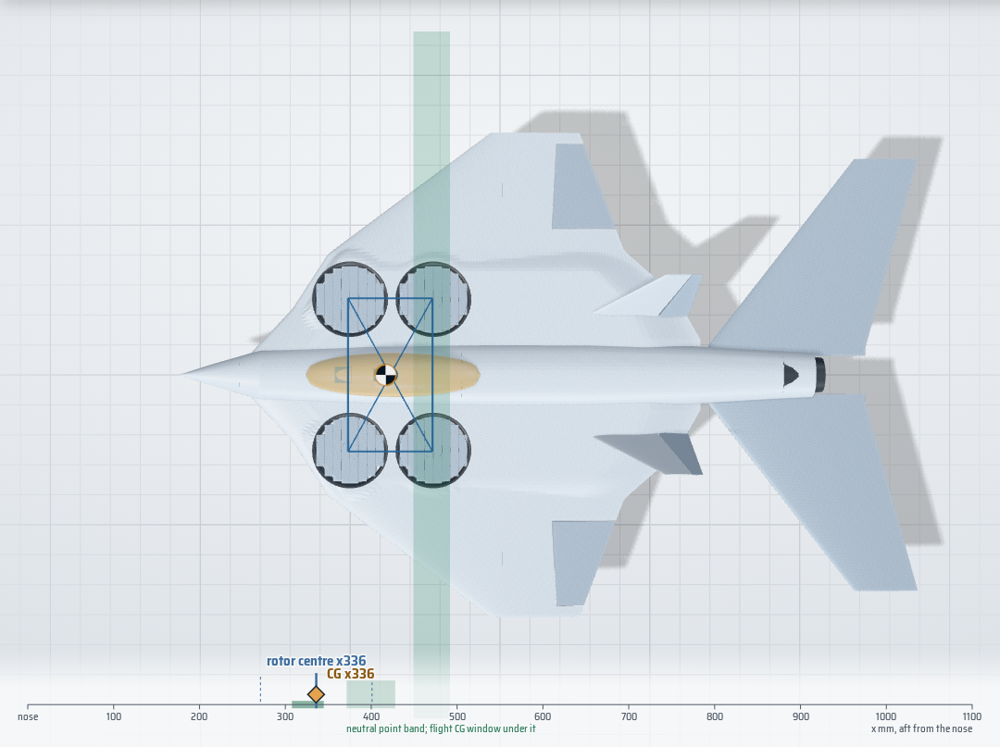

# V20 "Falcon Jet" (rev B): hidden lift fans, one jet, two scales

> **Status.** The mini is a buildable, 3D-printable experimental RC model: generated parts, a print set that fits the P1S, foam-tail templates, a parts list and a bench port map - not yet printed, bench-tested or flown. The full-scale aircraft is an **engineering concept study** of the same layout carrying one person: sizing, packaging and a regulatory path. It is not a build package and nothing here makes it airworthy. A person-carrying aircraft needs licensed aerospace engineering, structural and propulsion testing, a hazard analysis and FAA approval before anyone sits in it.

## The answer

|  | V20 mini (printable RC) | V20 full (single-seat concept) |
|---|---:|---:|
| Scale | 1 : 10 of the layout | 1 : 1 (shoulders widened for bigger fans) |
| Length x span | 995 x 760 mm | 10.80 x 8.80 m |
| Lift fans (hidden under louvres) | 4 x 106 mm ducts, one 4-inch 3-blade prop each | 4 x 1.56 m ducts, two contra-rotating 5-blade fans each |
| Jet | 64 mm EDF (Freewing E7206) behind the battery bay, fed by both side intakes | 0.64 m electric ducted fan, 925 kW |
| Power source | 4S2P Li-ion, 9 Ah, 90 A | series hybrid: 738 kW turbogenerator + 99 kWh battery |
| Mass | 1,548 g | 2,844 kg (pilot 100 kg, battery 550 kg, fuel 157 kg) |
| CG from the centre of the 4 fans | -0.2 mm | +0 mm |
| Hover power | 370 W | 1,263 kW (372 kg/m2 of fan) |
| Lift thrust / weight | 1.86 | 1.47 rated (one rotor may fail) |
| Static margin, louvres shut (cruise; gate) / open | **6.7** / 17.3 % (gate 5 %) | **1.9** / 19.2 % (positive; fly-by-wire) |
| Slowest wing-borne flight (trimmed CL at 14 deg) | 11.7 m/s (CL 0.51) | 41.9 m/s, 81 kt (CL 0.54) |
| Cruise (louvres shut) | 18.4 m/s, 242 W, L/D 4.5 | 277 km/h, 671 kW, L/D 6.8 |
| Endurance / mission | 17 min hover or 26 min cruise (model) | 20 km hop + 20 min VFR reserve |
| Hover and forward flight at every speed (quasi-steady model) | yes, 0-23 m/s | yes, 0-89 m/s |

Rev A (v0.7.0) had the four fans in open holes through a big delta wing. It worked on paper but looked like a drone glued into a jet, and the holes cost drag all the time. Rev B hides them.

## Why it looks like this

**Hover first.** Four lift fans in a square; the CG goes where their diagonals cross, so each fan lifts a quarter of the weight and every fan keeps the same control headroom. The battery is the trim weight: on the mini it sits in the nose (pack centre x 170 mm); on the full-scale aircraft in the nose bay between the turbogenerator and the pilot's feet (centroid x 2.12 m).

**Hidden fans.** The fans live in the shoulders of a wide, blended body, like the F-35's - beside the cockpit, the front pair right next to the pilot's seat. Louvres close each duct top and bottom in cruise, so the aircraft is a clean jet with no holes. On top they open by the fan's own suction and close with a light elastic; underneath they are servo-driven and double as **exit vanes**, turning the fans' efflux aft in transition (as on the 1960s XV-5 fan-in-wing).

**Then fly.** With the louvres shut the wing's lift comes back over the front fans and the neutral point moves forward, so the stability gate is the louvres-shut case. That is why the fans sit as far forward as the body allows, the trapezoidal outer wings sit well aft, and the all-moving stabilators are large: the vortex lattice puts the neutral point **6.7 %** of the mean chord behind the CG with the louvres shut (17.3 % with them open), after the fuselage's destabilising moment (Raymer's method). Stuck-open louvres therefore make it more stable, not less.

**The jet.** F-35-style side intakes sit just ahead of the front fans; behind them each duct carries on as a cheek under the body shoulder, inboard of the fans' lips and below their louvres, to one cruise fan near the CG. A thrust tube carries its jet to the round nozzle. On the mini that is the 64 mm EDF right behind the battery bay: an EDF in the tail would need a nose full of ballast, because the big stabilators and the wing behind the fans make the airframe tail-heavy. The intakes give 75 % of the EDF's swept area (EDF practice is 80-100 %); the cruise-power model includes that penalty, and the Stage 2 thrust test must be run through the printed intakes.

**Lighter tail.** The mini's stabilators, fins and rudders are cut from 3 mm Depron foam with a carbon rod (templates in `cad/v20/mini/foam/`): half the mass of printed surfaces, and the tail is where its balance is decided.

**Scaling up is not free.** At constant proportions the disk loading grows with size: mass goes as the cube, fan area as the square. With the mini's proportions the full-scale aircraft needs more than 350 kg/m2 of fan and does not close (trade study below), so the full scale widens the shoulders for 1.56 m fans and grows the outer wing and stabilators to keep it stable. Its louvres-shut margin is 1.9 %: positive, and enough for a triplex fly-by-wire aircraft, but thinner than the mini's.

## Hover at any point, fly forward at any point

At every speed from a standstill to top speed the model searches the wing's angle of attack and the pitch surfaces for the cheapest level-flight solution: the wing carries what it can, the four fans carry the rest and trim the pitch with front/rear differential thrust, and the cruise fan beats the drag - including the lift ducts' **momentum drag** (air taken in at flight speed and thrown down costs drag in proportion to speed). That drag is the classic fan-in-wing problem: on the full-scale aircraft it reaches several kilonewtons mid-transition, so the bottom louvres double as **exit vanes** that turn the efflux aft (up to 30 deg full scale, 15 deg on the mini). The louvres are open whenever the fans run (the model then uses the open-duct lattice and the holes' drag) and shut once the wing carries it all.

Mini (W):

| m/s | On wing % | Alpha deg | Pitch surfaces deg | Front / rear duct thrust, % of rated | Vanes deg | Power | Can stop and hover |
|---|---:|---:|---:|---:|---:|---:|---:|
| 0.0 | 0 | 0.0 | 0.0 | 54 / 54 | 0 | 370 | yes |
| 2.9 | 6 | 14.0 | -2.0 | 55 / 48 | 10 | 346 | yes |
| 5.8 | 21 | 14.0 | -6.0 | 49 / 39 | 15 | 349 | yes |
| 8.6 | 48 | 12.5 | -2.0 | 58 / 0 | 15 | 420 | yes |
| 11.5 | 82 | 14.0 | -7.0 | 19 / 1 | 15 | 478 | yes |
| 14.4 | 100 | 9.3 | -2.1 | 0 / 0 | 0 | 219 | yes |
| 17.2 | 100 | 6.5 | -1.5 | 0 / 0 | 0 | 229 | yes |
| 20.1 | 100 | 4.8 | -1.1 | 0 / 0 | 0 | 268 | yes |
| 23.0 | 100 | 3.6 | -0.8 | 0 / 0 | 0 | 352 | yes |

Full (kW):

| m/s | On wing % | Alpha deg | Pitch surfaces deg | Front / rear duct thrust, % of rated | Vanes deg | Power | Can stop and hover |
|---|---:|---:|---:|---:|---:|---:|---:|
| 0.0 | 0 | 0.0 | 0.0 | 68 / 68 | 0 | 1,262 | yes |
| 11.1 | 7 | 14.0 | 1.0 | 73 / 59 | 15 | 1,200 | yes |
| 22.1 | 25 | 14.0 | -2.0 | 80 / 38 | 30 | 1,060 | yes |
| 33.2 | 48 | 12.0 | -2.0 | 79 / 3 | 30 | 1,496 | yes |
| 44.3 | 100 | 12.6 | -0.8 | 0 / 0 | 0 | 803 | yes |
| 55.3 | 100 | 8.0 | -0.5 | 0 / 0 | 0 | 629 | yes |
| 66.4 | 100 | 5.6 | -0.3 | 0 / 0 | 0 | 609 | yes |
| 77.5 | 100 | 4.1 | -0.3 | 0 / 0 | 0 | 675 | yes |
| 88.5 | 100 | 3.1 | -0.2 | 0 / 0 | 0 | 804 | yes |

'Can stop and hover' means the four fans alone could take the full weight right now with 20 % of their thrust still in hand for control, and the power source could supply that 20 % extra on all four. Every solution in the table also stays inside the power source's limit (on the mini, the 90 A pack carries the lift fans and the EDF together). It is true at every speed on both scales: the fans are sized for hover, so the aircraft can always fall back to the drone. This is a **quasi-steady** model: each speed is solved on its own, without gusts, acceleration, pitch dynamics or fan-wing interference - it says a path exists, not that a pilot or autopilot can fly it. Flight test on the mini decides that.

## Build the mini

**Print set.** `cad/v20/mini/v20_mini_print_set.3mf` and `cad/v20/mini/stl/`: 35 pieces, every one a closed solid that fits the P1S bed (larger parts were cut with flat joints). Print the airframe in LW-PLA (foamed to about 0.6 g/cm3, one 0.45 mm wall, gyroid ribs), ducts and nozzle in PETG, the louvres in LW-PLA, the canopy as a buck for a 0.5 mm vacuum-formed PETG shell. Cut the stabilators, fins and rudders from 3 mm Depron with the 1:1 templates in `cad/v20/mini/foam/`. Glue the joints with the carbon spars running through them: a 6 mm main spar behind the rear fans in two halves that plug into a printed ring around the thrust tube, and a 4 mm centre spar through the strip between the front and rear fans. Louvres hinge on 0.8 mm music wire: the top ones close with a thin elastic and open by the fan's suction, the bottom ones are linked to one servo per side.

| Piece | P1S | Footprint mm | Height mm |
|---|---:|---:|---:|
| `canopy` | fits | 200 | 68 |
| `duct_front_L` | fits | 104 | 118 |
| `duct_front_R` | fits | 104 | 118 |
| `duct_rear_L` | fits | 104 | 118 |
| `duct_rear_R` | fits | 104 | 118 |
| `elevon_L` | fits | 74 | 132 |
| `elevon_R` | fits | 74 | 132 |
| `fuselage_p1` | fits | 83 | 250 |
| `fuselage_p2` | fits | 90 | 249 |
| `fuselage_p3` | fits | 91 | 249 |
| `fuselage_p4` | fits | 84 | 249 |
| `intake_L` | fits | 47 | 241 |
| `intake_R` | fits | 47 | 241 |
| `louvres_front_L` | fits | 74 | 105 |
| `louvres_front_R` | fits | 74 | 105 |
| `louvres_rear_L` | fits | 74 | 105 |
| `louvres_rear_R` | fits | 74 | 105 |
| `nozzle` | fits | 66 | 66 |
| `nozzle_cone` | fits | 24 | 48 |
| `vanes_front_L` | fits | 74 | 105 |
| `vanes_front_R` | fits | 74 | 105 |
| `vanes_rear_L` | fits | 74 | 105 |
| `vanes_rear_R` | fits | 74 | 105 |
| `wing_L_p1` | fits | 136 | 190 |
| `wing_L_p2` | fits | 147 | 190 |
| `wing_L_p3` | fits | 144 | 241 |
| `wing_L_p4` | fits | 149 | 181 |
| `wing_L_p5` | fits | 138 | 181 |
| `wing_L_p6` | fits | 139 | 236 |
| `wing_R_p1` | fits | 144 | 241 |
| `wing_R_p2` | fits | 136 | 190 |
| `wing_R_p3` | fits | 147 | 190 |
| `wing_R_p4` | fits | 138 | 236 |
| `wing_R_p5` | fits | 149 | 181 |
| `wing_R_p6` | fits | 138 | 181 |

**Masses** (model, 1,548 g): airframe 424 g, propulsion 344 g, avionics 60 g, controls 57 g, systems 50 g, gear 32 g, battery 580 g.

**Parts to buy** (reference candidates; buy one lift motor and one prop first and measure them on the repo's thrust stand before the rest):

| ID | Item | Reference candidate | Qty | USD |  |
|---|---:|---:|---:|---:|---:|
| M01 | Lift motors (4 + 1 spare) | 2204-2205 class, 2600-3200 KV, 4S (tested reference: a 2204 3200 KV made 965 g with HQProp 4x4x3 on 4S) | 5 | 60-100 | [link](https://www.miniquadtestbench.com/epicrc-2204-3200kv.html) |
| M02 | Lift props, 4-inch 3-blade (2 sets of CW + CCW) | HQProp 4x4x3 or similar, 5 mm bore | 8 | 8-15 | [link](https://www.amazon.com/s?k=hqprop+4x4x3) |
| M03 | 4-in-1 lift ESC | V18 row P06: Hobbywing XRotor Micro 60A 4-in-1 | 1 | 65-100 | [link](https://www.hobbywing.com/en/products/xrotor-micro-60a-4in1-blheli-32-dshot1200117) |
| M04 | Cruise EDF, 64 mm | V18 row P07: Freewing E7206 64 mm 4S | 1 | 60-85 | [link](https://www.freewingmodel.com/747.html) |
| M05 | EDF ESC | V18 row P08: Hobbywing Skywalker 60A V2 | 1 | 35-45 | [link](https://www.hobbywingdirect.com/products/skywalker-esc-60a) |
| B01 | Li-ion cells for a 4S2P pack (+ 1 spare) | Molicel P45B 21700, 4.5 Ah, 45 A, about 70 g | 9 | 30-45 | [link](https://www.getfpv.com/batteries/18650-batteries/molicel-p45b-21700-4500mah-45a-3-7v-li-ion-battery-2pcs.html) |
| B02 | Pack build: nickel strip rated for 90 A, balance lead, XT90, fish paper, heat-shrink (or a pre-built 4S2P P45B pack) | spot-welded, never soldered to the cells | 1 | 20-40 | [link](https://www.amazon.com/s?k=4s2p+21700+p45b+pack) |
| B03 | Li-ion-capable 4S balance charger | V18 row X07 (set to Li-ion, 4.2 V/cell, 4.5 A) | 0 | - | [link](https://www.amazon.com/s?k=lipo+balance+charger+4s) |
| A01 | Flight controller | V18 row A01: SpeedyBee F405 WING | 1 | 50-80 | [link](https://ardupilot.org/plane/docs/common-speedybeef405wing.html) |
| A02 | ELRS receiver | V18 row A03: RadioMaster RP1 V2 | 1 | 19-25 | [link](https://radiomasterrc.com/products/rp1-expresslrs-2-4ghz-nano-receiver) |
| A03 | GNSS + compass | V18 row A04: M10 GNSS with I2C compass | 1 | 25-50 | [link](https://ardupilot.org/plane/docs/common-positioning-landing-page.html) |
| A04 | Airspeed sensor + pitot | V18 row A05: Matek ASPD-4525 | 1 | 35-65 | [link](https://www.mateksys.com/?portfolio=aspd-4525) |
| A05 | Servos (2 elevons, 2 stabilators, 1 rudders, 2 bottom louvres + 1 spare) | 5 g digital micro servo, metal gear | 8 | 48-80 | [link](https://www.amazon.com/s?k=5g+digital+metal+gear+micro+servo) |
| A06 | Lost-model alarm | V18 row A06: VIFLY Finder 2 | 1 | 10-14 | [link](https://www.getfpv.com/vifly-finder-2-drone-buzzer.html) |
| V01 | FPV camera, 19 mm (pilot's eye) | V18 row V01: RunCam Phoenix 2 | 1 | 30-40 | [link](https://shop.runcam.com/runcam-phoenix-2/) |
| V02 | VTX + antenna | V18 row V02 | 1 | 25-45 | [link](https://www.runcam.com/download/RunCam-TX200U-US-manual.pdf) |
| S01 | Carbon tubes: 6 x 4 mm (main spar + keel), 4 x 2 mm (centre spar), 1 m each | pultruded carbon | 3 | 15-30 | [link](https://www.amazon.com/s?k=carbon+fiber+tube+6mm+4mm+1000mm) |
| S02 | Clear PETG sheet 0.5 mm (vacuum-formed canopy; spares) | A4 sheets | 3 | 8-15 | [link](https://www.amazon.com/s?k=petg+sheet+0.5mm+clear) |
| S06 | Depron 3 mm sheet (stabilators, fins, rudders; templates in cad/v20/mini/foam) + 2 mm carbon rod | Depron or EPP-free foamboard of similar density | 1 | 10-18 | [link](https://www.amazon.com/s?k=depron+3mm+sheet) |
| S07 | Louvre hinges: 0.8 mm music wire, thin elastic thread (top louvres close by elastic, open by fan suction) |  | 1 | 5-8 | [link](https://www.amazon.com/s?k=0.8mm+music+wire) |
| S03 | PET film 0.2 mm (EDF thrust tube, intake ducts) | A4 sheets | 3 | 6-10 | [link](https://www.amazon.com/s?k=0.2mm+pet+film+sheet) |
| S04 | Landing gear: 1.5 mm music wire, 30 mm foam wheels x3, wheel collars |  | 1 | 10-18 | [link](https://www.amazon.com/s?k=30mm+foam+wheels+rc) |
| S05 | Pushrods, clevises, horns, pull-pull cable for the rudders | 1.2 mm wire set | 1 | 8-12 | [link](https://www.amazon.com/s?k=rc+pushrod+clevis+control+horn+set) |
| C01 | Filament: LW-PLA (airframe), PETG (ducts, nozzle, mounts) | V18 row C05 | 1 | 35-55 | [link](https://www.amazon.com/s?k=lw-pla+filament) |

**Battery.** A 4S2P Li-ion pack of eight 21700 cells (Molicel P45B class: 4.5 Ah, 45 A continuous, about 70 g each) as two 2 x 2 bundles end to end in the nose: 9 Ah and 90 A, 580 g. Hover needs about 28 A; the model keeps lift fans + EDF under 1,010 W (85 % of 90 A at 13.2 V under load) everywhere in the corridor, so the EDF runs to full throttle and `Q_M_BAT_CURR_MAX` is 76 A. Li-ion gives about 40 % more energy per kilogram than LiPo, which long hovers want; the price is current, which is why the pack is 2P. Lift thrust is limited by the motor and prop (lift thrust/weight 1.86).

**Wiring.** SpeedyBee F405 WING, ArduPilot QuadPlane (quad X), bench-only port map in `config/ardupilot/skyforge_v20_mini_BENCH_ONLY.param`:

| Output | ArduPilot function | Goes to | Note |
|---|---:|---:|---:|
| S1 | 33 Motor1 | 4-in-1 M1: front-right duct (CCW) | DShot group 1-2 |
| S2 | 34 Motor2 | 4-in-1 M2: rear-left duct (CCW) | DShot group 1-2 |
| S3 | 35 Motor3 | 4-in-1 M3: front-left duct (CW) | DShot group 3-4 |
| S4 | 36 Motor4 | 4-in-1 M4: rear-right duct (CW) | DShot group 3-4 |
| S5 | 77 Elevon left | left elevon servo | PWM 50 Hz, group 5-7 |
| S6 | 78 Elevon right | right elevon servo | PWM 50 Hz, group 5-7 |
| S7 | 77 Elevon left | left stabilator servo | stabilators mix like elevons (pitch + roll); reverse if needed |
| S8 | 78 Elevon right | right stabilator servo | group 8-10 |
| S9 | 21 Rudder | rudder servo (pull-pull to both rudders) | group 8-10 |
| S10 | 94 Script1 | right bottom-louvre servo (front + rear right ducts) | group 8-10; open in VTOL, shut in cruise, vectored aft in transition - needs a Lua script (open item) |
| S11 | 70 Throttle | EDF ESC signal | group 11-12; full throttle allowed (the 90 A pack covers EDF + lift fans) |
| S12 | 95 Script2 | left bottom-louvre servo (front + rear left ducts) | group 11-12; same script |
| UART1 | SERIAL1_PROTOCOL 23 | ELRS receiver (CRSF) | Rx TX -> R1, Rx RX -> T1 |
| UART3 | SERIAL3_PROTOCOL 5 | M10 GNSS | compass on I2C |
| I2C | ARSPD_TYPE 1 | ASPD-4525 airspeed | pitot through the nose, 30 mm ahead of the skin |

**Gates before the first hover** (on top of the repo's Stage 0-10):

- Thrust stand: one ducted 4-inch prop on its motor gives at least 0.72 kg at full throttle on 4S, with the louvres open; below that, change motor or prop before printing the body.
- EDF bench: the E7206 run through the printed intakes and thrust tube - record thrust and current; the model assumes the intakes cost some thrust (they give about three quarters of the fan's swept area).
- Louvres: the top ones open fully at hover throttle and shut with the fan off; the bottom ones open, shut and vector aft on the servo, and the trim position is OPEN.
- Weigh and balance: the CG within 3 mm of x 336 mm (centre of the four ducts); move the pack, not ballast.
- Duct tip gap: 2.1 mm in the model (measured from the meshes) - check it all round with a feeler, no rub when you flex the body shoulder by hand.
- Props off: motor order and direction per the port map, every surface moves the right way in every mode.
- Tethered hover: hover throttle 40-50 %, no oscillation; then free hover; then transitions in steps of 2 m/s.
- Battery current: logged peak under 76 A in hover and transition.
- Airspeeds: AIRSPEED_MIN 16 m/s and Q_ASSIST_SPEED 15 m/s come from the model's 11.7 m/s slowest wing-borne speed; confirm the real stall in a climb before lowering them.

## The full-scale aircraft (concept study)

**Why it is a hybrid.** With honest efficiencies (fan figure of merit 0.70, the cruise fan from momentum theory through the intakes, the delta's drag due to lift, a usable CL from the trimmed lattice) and the legal VFR reserve, an all-electric version does not close in the trade study below - not at 220 Wh/kg and not at 300. Hidden fans are small fans: even widened to 1.56 m the disk loading is 372 kg/m2 (an open-rotor eVTOL runs 50-100), so hover takes 1,263 kW, and the 20-minute reserve at cruise is 223 kWh. Jet fuel carries that for a fraction of a battery's mass. So the full scale is a **series hybrid**: a turboshaft-driven generator in the nose, where a fighter has its radar (it is the heaviest thing that can go forward of a tail-heavy airframe), fed from the intake ducts, its exhaust in two insulated pipes beside the cockpit into the thrust tube - the exhaust leaves through the jet nozzle. The battery fills the nose bay between the turbine and the pilot's feet and trims the CG; fuel is in the outer wings. This is what the 1960s fan-in-wing XV-5 found with turbojets: a fighter-shaped fan lifter is a jet-fuel aircraft, and a heavy one.

Closed sizing loop (`tools/v20/sizing.py`): pilot 100 kg; generator 738 kW (cruise and reserve power + 10 %) at 1.5 kW/kg and 0.5 kg of fuel per kWh; battery 180 Wh/kg at pack level, sized by power (hover minus generator) at 10C; lift motors and inverters rated so that **any one of the eight rotors can fail** - re-splitting thrust onto the diagonal keeps pitch and roll trimmed, and the busiest healthy rotor then carries 1/6 of the weight (+10 % for control), for the 60 s it takes to land; cruise fan sized to beat the drag from 1.1 x stall to 1.15 x cruise speed and the transition's momentum drag; structure from the generated wetted areas at composite areal densities; systems including a triplex flight-control system and a ballistic parachute.

| Group | Mass |
|---|---:|
| structure | 693 kg |
| payload | 100 kg |
| systems | 143 kg |
| propulsion | 1,200 kg |
| fuel | 157 kg |
| battery | 550 kg |
| **MTOW** | **2,844 kg** |

Mission (60 s hover + 30 s transition, 20 km at 277 km/h, transition and 60 s hover, then a 20 min reserve + 60 s hover): hover 42, transition 16, cruise 48, reserve 223 kWh at the bus; the generator supplies 299 kWh (157 kg, 197 L of Jet A in the outer-wing tanks; burning it all moves the CG 29 mm forward) and the battery 30 kWh of its 99 kWh. Battery power is sized for the larger of hover with 20 % thrust in hand and the transition's peak (from the corridor), less the generator; the cruise fan's thrust for the transition's momentum drag as well as cruise.

**The open safety item: turbine out in a low hover.** The battery is sized for hover power minus the generator, so with the turbine stopped it supplies 78 % of hover power - about 85 % of the thrust needed. Above parachute height that is a parachute or a powered descent; in a low hover it is a hard landing. Single-engine helicopters live with the same kind of height-velocity avoid region. The safe rule - the battery alone holds a 60 s hover - is in the trade study; twin turbogenerators, bigger fans or a lower disk loading are the ways out, and a real program would have to pick one.

**Packaging (open).** The generated full-scale model (`cad/v20/full/checks.json`) holds the pilot, the nose turbogenerator, the exhaust pipes, the intake ducts, the cruise fan, the parachute, the inverters and 274 L of wing tanks (216 L needed) without collisions - but only **31 %** of the 550 kg battery fits the nose bay between the turbine and the pilot's feet. The rest has nowhere to go in a body this slim: more volume in the nose (a deeper forebody), a denser pack, or a lighter, less tail-heavy airframe that needs less battery as trim weight. This is a real finding of the concept, not a rounding error.

Trade study (every row carries the 20-minute reserve):

| Case | Size | Cruise km | Powertrain | MTOW kg | Battery kg | Fuel kg | Hover kW |
|---|---:|---:|---:|---:|---:|---:|---:|
| mini proportions (1.06 m fans) | 9.9 m, 1.06 m fans | 20 | hybrid | does not close | - | - | - |
| full shape | 10.8 m, 1.56 m fans | 10 | hybrid | 2,720 | 527 | 136 | 1,181 |
| full shape | 10.8 m, 1.56 m fans | 20 | hybrid | 2,844 | 550 | 157 | 1,263 |
| full shape | 10.8 m, 1.56 m fans | 50 | hybrid | does not close | - | - | - |
| full shape, battery alone holds a 60 s hover | 10.8 m, 1.56 m fans | 20 | hybrid | does not close | - | - | - |
| full shape | 10.8 m, 1.56 m fans | 20 | battery 220 Wh/kg | does not close | - | - | - |
| full shape | 10.8 m, 1.56 m fans | 20 | battery 300 Wh/kg | does not close | - | - | - |
| full shape, 1.2x larger | 13.0 m, 1.87 m fans | 20 | hybrid | does not close | - | - | - |

Read it from the top: the mini's own proportions do not close at full scale (fans too small for the weight); the widened full-scale shape closes only as a hybrid; mass climbs steeply with distance, because every kilogram of fuel and generator raises the hover power, which sizes the battery and the motors; and a bigger aircraft is heavier, not better. **This is a heavy aircraft for one person.** If the full scale is the goal, the honest lever is bigger fans - which means a less fighter-like body - or the F-35B's architecture (one large shaft-driven lift fan and a swivelling engine nozzle), not more styling.

**Safety architecture (what a real program would have to carry):**

- Eight motors in four coaxial ducts. Any one motor, inverter or blade-out leaves enough thrust (sized above); the lost rotor's torque is no longer cancelled, so yaw must be held by the other pairs' differential speed, the exit vanes and the rudders - not yet checked by this model. A motor failure in mid-transition is also an open item. Ducts contain blade fragments only if the shroud is designed and tested for it.
- Triplex fly-by-wire with independent air-data and attitude sources; the aircraft is a hover machine first and has no unpowered hover.
- Turbine out: see above - the avoid region has to be closed or flown around.
- Battery split into isolated strings with contactors, thermal-runaway barriers and venting overboard; the nose bay is forward of the pilot's feet, so the crash case and the fire case both need a firewall. Fuel tank crash-resistant and separated from the battery bays.
- Ballistic recovery parachute behind the canopy for loss of control or power in cruise and climb. It needs height and some speed to open, so it does **not** protect a low hover or the start of a transition.
- Duct exit vanes for transition thrust and yaw; elevons and stabilators for wing-borne control; the cruise fan is not needed to land.
- Fuel and energy state and power margin shown to the pilot at all times.

**Regulatory path, full scale (United States).** This aircraft is far outside Part 103 ultralight limits (single occupant, under 254 lb empty, 55 kt maximum, 24 kt stall: see [EAA's summary of 14 CFR 103](https://www.eaa.org/eaa/aviation-interests/ultralights/getting-started-in-ultralight-flying/about-faa-part-103-for-ultralights)), so it would need an FAA airworthiness certificate - for a privately built one-off, a special airworthiness certificate in the experimental category - and a pilot qualified for powered-lift under the FAA's 2024 powered-lift rule, SFAR 120 ([FAA](https://www.faa.gov/newsroom/integration-powered-lift-pilot-certification-and-operations-miscellaneous-amendments)). **Reserve:** under 14 CFR 194.302 (SFAR 120, Table 1, row l) a powered-lift that can land in the vertical-lift mode along the whole route may use the rotorcraft VFR rule, 14 CFR 91.151(b): fuel to the first intended landing plus 20 minutes at normal cruise ([final rule](https://public-inspection.federalregister.gov/2024-30331.pdf), [91.151](https://www.law.cornell.edu/cfr/text/14/91.151)); otherwise the airplane rule applies, 30 minutes by day and 45 at night. The sizing uses 20 minutes plus a 60 s hover for that vertical landing. Which experimental purpose applies to a powered-lift one-off, and what testing the FAA would want, is a question for the local FAA office (FSDO/MIDO) and a Designated Airworthiness Representative before any metal is cut. This is a summary, not legal advice.

**The mini's rules (United States).** At about 1.5 kg it is a small unmanned aircraft: register it with the FAA (over 250 g), fly it with a standard Remote ID module or broadcast, or at an FAA-recognized identification area; as a recreational flyer pass TRUST and fly under 400 ft in uncontrolled airspace (or get a LAANC authorization in controlled airspace) and keep it in sight - FPV needs a visual observer beside you; flying it for work needs a Part 107 certificate ([FAA recreational flyers](https://www.faa.gov/uas/recreational_flyers), [Remote ID](https://www.faa.gov/uas/getting_started/remote_id)).

**Before anyone flies in one:** detailed structural design and analysis with test articles; duct and rotor burst containment testing; battery abuse testing; turbine and fuel-system qualification; a functional hazard assessment and failure-modes analysis of the flight control system; a scale-model and then unmanned full-scale flight-test program (the mini is step one); and a team with aerospace engineers who sign for the work.

## How the numbers were made

- `tools/v20/v20params.py`: the master shape (full-scale metres). `tools/v20/geometry.py`: meshes for both scales, the mini print set and the checks (insides within the fuselage, prop tip gap, P1S fit). `tools/v20/aero.py`: vortex lattice of the planform with the ducts open (louvres open) or covered (louvres shut) and the stabilators (same solver as `tools/aero_vlm.py`, within 0.3 % of AeroSandbox) plus Raymer's fuselage correction. `tools/v20/sizing.py`: masses and CG, momentum-theory hover power with figures of merit, Raymer flat-plate drag build-up, the corridor search, the full-scale sizing loop and the trade study.
- Assumptions to replace with measurements first: LW-PLA and Depron areal densities (Stage 1 coupons), ducted 4-inch thrust and current (thrust stand), the EDF's thrust and power at speed, the fan figures of merit (mini 0.48, full 0.70), the duct-hole drag and blockage, the leading-edge suction (mini 0.2, full 0.5), the turbogenerator's mass and fuel burn. Every number in this document moves when those do; rerun `make v20`.
- Not modelled: duct lip suction and fan-wing interference in transition (they help lift and hurt pitch), ground effect, gusts, the dynamics of the transition (this is a quasi-steady corridor), structural loads and flutter.

